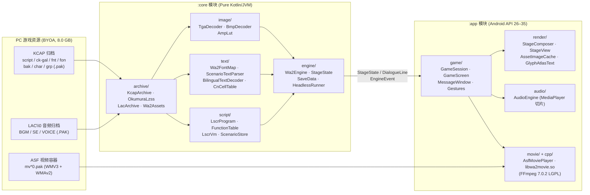

# White Album 2 Android 移植版开发文档 (Documentation Index)

欢迎查阅 `wa2port`（《白色相簿2 / White Album 2》PC 原版 + 澄空学园 CK-GAL 汉化版 Android 洁净室重实现引擎）开发文档。本项目以纯 Kotlin/JVM 编写跨平台核心引擎（`:core`），结合 Jetpack Compose、Android Canvas 硬件加速合成器与 NDK FFmpeg 原生解码器（`:app`），在不打包任何版权资源（BYOA, Bring Your Own Assets）的前提下，实现了原汁原味的中日双语同屏显示与移动端触控体验。

## 文档导航 (Contents)

| 文档 | 核心内容 |
|---|---|
| **[`reverse-engineering.md`](./reverse-engineering.md)** 逆向工程详尽规范 | 针对 `WA2.exe` / `WA2_chs.exe` 及全部 49 个数据包的逆向工程成果汇总： • **容器与压缩**：`KCAP` 归档格式、CK-GAL 重打包 `csize` 少 8 字节缺陷、Okumura LZSS 算法、`LAC\0` 音频归档（`0xFF` 异或文件名） • **图像与调色**：`char.pak` 角色立绘 `bpp=0` 缺陷与预乘 Alpha（`α=0` 与 `α=2` 透明底）、`f0%03d.bmp` 遮罩、`.AMP` 5×256B 查找表公式 `T0[Tc[c]]` 与背景/立绘双槽位路由、`FB`/`F` 顶点亮度调制公式 • **字体与双语文本**：`fnt.pak`/`fon.pak` 图集、`WA2.exe` 59 段编码映射表（7655 格，含 `0x7F` 尾字节）、CK-GAL 汉化字库区间（`748–4349`）、`4320–4350` 错位一格 Bug 修复表、7 个游离错字字节、`.txt` 逗号分词与中日 1:1 严格对齐证明 • **LSCR 字节码与引擎函数**：`.bnr` 容器结构、绝对字节跳转偏移、词法 Tag、28 个 RPN 运算符、14 个控制流指令（`if/elif/else`、`for`、`switch`、`goto`）、`.fnc` 函数签名表、84 个实装引擎函数语义详解（立绘前缀/坐标表、背景/CG/过渡模式、语音/BGM/SE、WMV3/WMAv2 视频、`Global.vrb` 与 `GFLAG.dat`）、`.psh` 着色器与 `.ani` 动画现状 |
| **[`architecture.md`](./architecture.md)** 系统架构与设计说明 | 代码模块划分与运行时设计架构： • **模块与包结构**：`:core`（纯 JVM）与 `:app`（Android UI / 渲染 / 音频 / 视频）职责边界 • **单向数据流**：`Wa2Engine` → `StageState` / `DialogueLine` / `EngineEvent` → `GameSession` → 渲染与音频后端 • **LSCR 虚拟机执行模型**：后缀表达式求值、基于语句起点的可恢复阻塞调用（Resumable Blocking Calls）、快进逐帧推进机制 • **舞台合成与双语排版**：`StageComposer` 离屏预合成与 `StageView` 实时特效、`GlyphAtlasText` 双通道字形图集渲染、中日双语左右分栏（18 字定宽折行、句末智能重排、自适应字号缩放） • **音频、视频、存档与线程模型**：`LAC` 零拷贝切片播放、FFmpeg JNI 双队列音画同步、JSON 存档与 `ReadTracker` 既读行集追踪、多线程职责与核心设计决策 |
| **[`build-and-test.md`](./build-and-test.md)** 构建、测试与部署指南 | 完整的本地开发、自动化测试与真机/模拟器部署手册： • **环境要求**：JDK 21、Android SDK 35、NDK 27、CMake 3.22.1 • **桌面端测试 (`:core:test`)**：通过 `-Dwa2.root` / `WA2_ROOT` 直接针对 8.0 GB 真实游戏目录运行全量归档、图像、脚本对齐及 187 场景全语料无头通关测试 • **Android 构建与 FFmpeg 重编译**：`:app:assembleDebug`、`build_ffmpeg.sh` 最小化 LGPL FFmpeg 7.0.2 编译脚本与 `test_probe.sh` 独立解码探针 • **ACID 模拟器与设备部署**：APK 安装、完整资源/精简测试包（Mini-Pack）`adb push` 路径、应用内 SAF 断点续传导入及常见问题排查 |
| **[`WA2_LSCR_Spec.md`](./WA2_LSCR_Spec.md)** 原始英文速查表 | 早期从 `WA2.exe` 提取的字库区间表与 LSCR 字节码速查规范（英文原稿，已完整并入并扩充至 [`reverse-engineering.md`](./reverse-engineering.md)）。 |

## 系统总览 (System Overview)

