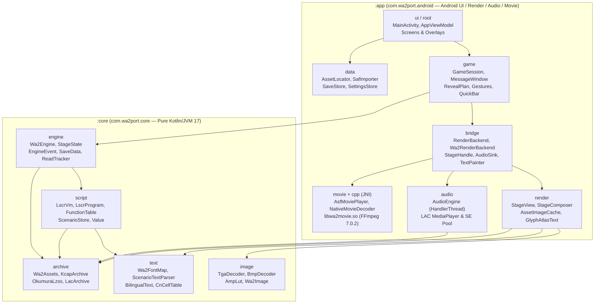
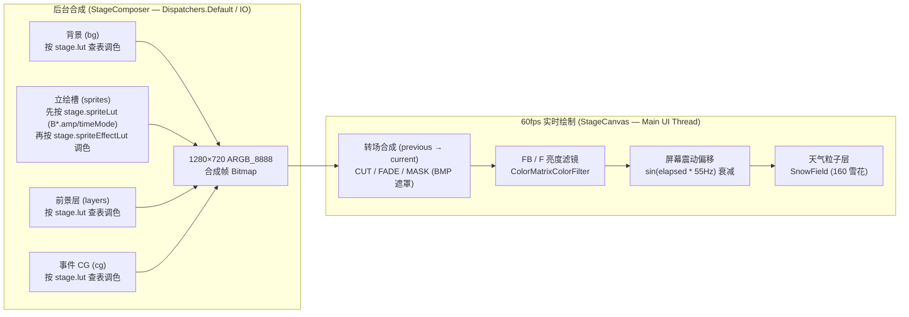
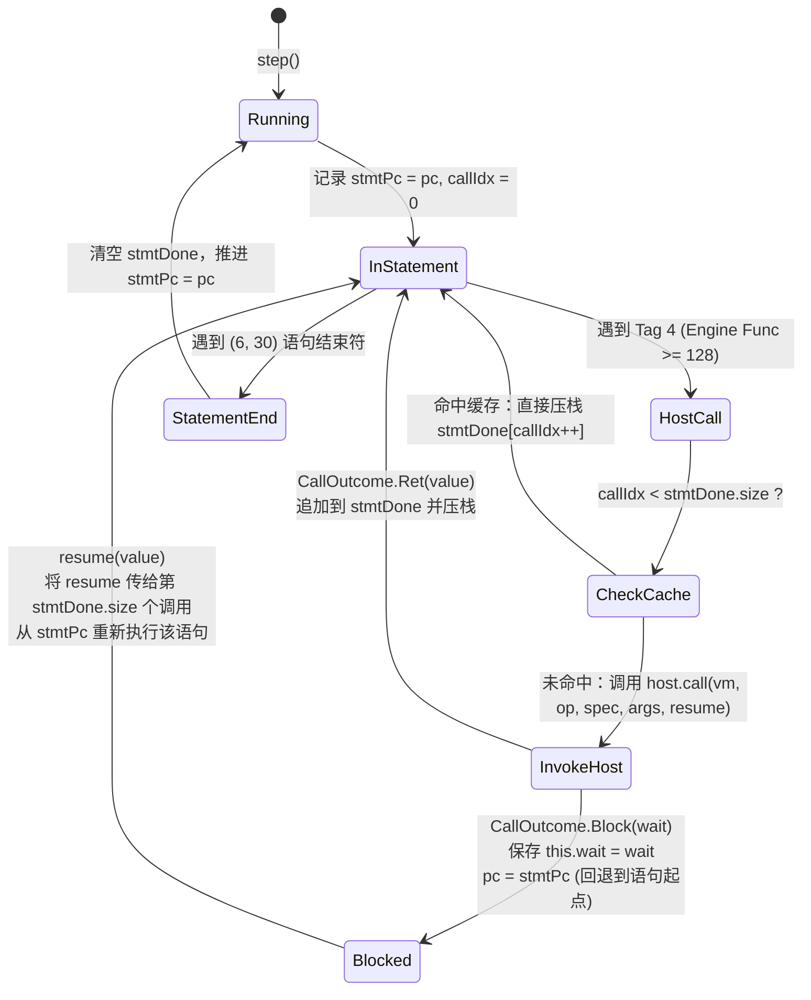

# 架构设计 (Architecture)

本文档介绍 WA2 Android 移植项目的模块结构、核心数据流、LSCR 虚拟机可重入挂起模型、存读档与既读追踪、线程并发模型以及关键工程决策。

---

## 1. 模块与包结构 (Module & Package Map)

项目分为两个 Gradle 模块：

- **`:core` (`com.wa2port.core`)**：纯 Kotlin / JVM 17 跨平台引擎库，零 Android 依赖（唯一第三方依赖为 `kotlinx-serialization-json:1.7.3`）。可在桌面 JVM 直接通过 JUnit 5 对真实游戏目录进行全量回归测试与无头巡检。
- **`:app` (`com.wa2port.android`)**：Android 前端应用（`minSdk = 26`, `targetSdk = 35`），基于 Jetpack Compose、Canvas、`MediaPlayer` 与 NDK/FFmpeg 构建。



### 1.1 `:core` 包职责

| 包路径 | 核心类 / 文件 | 职责说明 |
|---|---|---|
| `com.wa2port.core.archive` | `PositionalFile`, `KcapArchive`, `OkumuraLzss`, `LacArchive`, `Wa2Assets` | 基于 `FileChannel.read(buf, pos)` 的无锁并发文件读取；解析 `KCAP` 包与 Okumura LZSS 解压；解析 `LAC\0` 音频归档并提供零拷贝字节切片 `FileSlice`；统一处理松散目录、`patch.pak`、`<dir>.pak` 与 `IC/<dir>.pak` 的大小写无关查找。 |
| `com.wa2port.core.image` | `Wa2Image`, `TgaDecoder`, `BmpDecoder`, `AmpLut` | 平台无关的预乘 Alpha 图像容器（`0xAARRGGBB`）；TGA 解码（含 `bpp=0` 头修复与 8-bit 调色板字库通道提取）；BMP 图像与 256 阶转场遮罩（`maskLevels`）提取；`.AMP` 双表级联色彩查找表（`T0[Tc[c]]`）与时段默认 LUT。 |
| `com.wa2port.core.text` | `Wa2FontMap`, `ScenarioTextParser`, `BilingualText`, `CnCellTable` | 59 段 SJIS → 字库格映射表（Table B，7,655 格）；CP932 剧本控制符词法解析（`\n`, `\k`, `<R..\|..>`, `<W..>`, `<F..>`, `<S..>`）；CK-GAL 汉化版 cell `748..4349` 反查表（`cn_cells.tsv`）与末尾 31 字 `4320..4350` 错位修正表（`cn_render_remap.tsv`）。 |
| `com.wa2port.core.script` | `Value`, `FunctionTable`, `LscrProgram`, `LscrVm`, `ScenarioStore` | 逆向自 `WA2_chs.exe` 的 LSCR 脚本引擎：解析 `function.fnc`（含参数签名与默认值）；解析 `.bnr` 字节码并预扫描 `if/elif/else` 块尾与 `for` 步进入口；执行后缀表达式（RPN）与控制流；对齐加载 `script.pak`（日文）与 `ck-gal.pak`（中文）同序号双语词条及 `Global.vrb` / `GFLAG.dat`。 |
| `com.wa2port.core.engine` | `Wa2Engine`, `Stage`, `StageState`, `EngineEvent`, `SaveData`, `HeadlessRunner` | 游戏主状态机：实现 ~150 个引擎内置函数（`LscrVm.Host`），维护不可变舞台快照 `StageState` 与一次性事件队列 `EngineEvent`，管理计时器（Wait / Transition / Tint / Shake / Choice / Movie / Message）、存读档序列化、全局标志与既读位图 `ReadTracker`。 |
| `com.wa2port.core.gallery` | `CgGallery`, `BgmGallery`, `SceneReplayGallery` | 鉴赏与回想目录索引器：<br>• `CgGallery`：加载 `WA2.exe` `.data 0x4c01b0` 卡片表（`cg_cards.tsv`，149 张卡片 / 272 个变体），结合 `SystemData.cgFlags` 判定解锁状态；<br>• `BgmGallery`：63 首音乐鉴赏目录（`.data 0x4c1dd0`），处理 `gflags[100 + bgmId]` 解锁、#25 `BGM_021/035` 切换与 #31 完整版主题曲联动解锁，解析 `_A`+`_B` 无缝循环事件；<br>• `SceneReplayGallery`：24 幕场景回想目录（`.data 0x4c1bf0`），提供中日双语标题、女主分类、`tv%06d.tga` 预裁切缩略图解析与 `gflags[80 / 300..322]` 解锁判定。 |

### 1.2 `:app` 包职责

| 包路径 | 核心类 / 文件 | 职责说明 |
|---|---|---|
| `com.wa2port.android` (root & `ui/`) | `MainActivity`, `AppViewModel`, `Screens.kt`, `CgGalleryScreen.kt`, `BgmGalleryScreen.kt`, `SceneReplayScreen.kt`, `Overlays.kt` | 横屏沉浸式 Activity；轻量级页面栈导航（`Title`, `Game`, `Gallery`, `BgmGallery`, `SceneReplay`, `Config`, `Assets`, `Load`）；CG 鉴赏网格与全屏缩放查看器；63 曲音乐鉴赏播放器（`BgmGalleryScreen`）；24 幕场景回想网格（`SceneReplayScreen`，通过 `9999.bnr` 与 `replayMode` 启动并在结束后返回回想页）；存档/读档弹窗、回想历史（Backlog）、设置面板与主菜单 UI。 |
| `com.wa2port.android.data` | `AssetLocator`, `SafImporter`, `SaveStore`, `SettingsStore` | 自动探测外部存储或 `/data/local/tmp/wa2` 中的游戏资源；通过 Android SAF (`DocumentsContract`) 断点续传导入游戏目录；管理 24 个存档槽 + 快速存档槽（含 320×180 JPEG 缩略图与原子写文件）；持久化语言、文本框模式、音量与文字速度配置。 |
| `com.wa2port.android.bridge` | `RenderBackend`, `Wa2RenderBackend`, `StageHandle`, `AudioSink`, `TextPainter` | 连接 `:core` 状态/事件与 Android 渲染/音频子系统的桥接层；内含 `AtlasTextPainter`（带 160 项 `IdentityHashMap` LRU 布局缓存）。 |
| `com.wa2port.android.game` | `GameSession`, `MessageWindow`, `RevealPlan`, `Gestures`, `QuickBar` | 驱动每帧更新的会话控制器：协调 `Wa2Engine.update(dtMs)`、消费 `EngineEvent`、执行跨 `\k` 段的打字机揭示计划（`RevealPlan`）、管理 `AUTO`/`SKIP` 模式、绘制 ADV 双栏双语对话框与 NOVEL 全屏电子书模式、处理触控手势。 |
| `com.wa2port.android.render` | `StageView`, `StageComposer`, `AssetImageCache`, `GlyphAtlasText`, `MoviePlayer` | 1280×720 16:9 舞台渲染器：150 MB 预乘 `ARGB_8888` Bitmap LRU 缓存与异步 `.AMP` 调色缓存；后台合成 `bg → sprites → layers → cg` 单张帧位图；执行 `CUT`/`FADE`/`MASK`（`ColorMatrixColorFilter` 软阈值斜率 + `PorterDuff.Mode.DST_IN`）转场、实时 `FB`/`F` `ColorMatrixColorFilter` 亮度偏移、屏幕震动与 160 片程序化降雪；基于 `本体80.tga` + `袋影80.tga` 的双通道字库图集排版与绘制。 |
| `com.wa2port.android.audio` | `AudioEngine` | 独立 `HandlerThread("wa2-audio")` 音频引擎：通过文件描述符偏移（`fd, offset, length`）直接从 `LAC\0` 归档播放 Ogg Vorbis；利用 `setNextMediaPlayer` 实现 `_A → _B` 无缝循环 BGM；20 ms 步进音量淡入淡出；支持 4 通道循环环境音效（SE 0..3）、并发短音效池与单通道角色语音（`VI`/`VV`/`VX`）。 |
| `com.wa2port.android.movie` & `src/main/cpp` | `AsfMoviePlayer`, `NativeMovieDecoder`, `wa2movie.c` | 基于 JNI 与定制编译 LGPL FFmpeg 7.0.2（`libwa2movie.so`）的 `.asf`（WMV3 + WMAv2）软解播放器，通过 `SurfaceView` + `AudioTrack` 同步输出音画。 |

---

## 2. 核心数据流 (Engine → StageState / EngineEvent → Renderer / Audio)

系统采用**单向数据流（Unidirectional Data Flow）**：`:core` 中的 `Wa2Engine` 不持有任何 UI 或平台引用，仅在每帧推进脚本与计时器后产出两类输出：

1. **`StageState`（持久状态快照）**：描述当前时刻舞台的完整视觉状态（背景、立绘槽、叠加层、CG、`.AMP` 调色盘、`FB`/`F` 亮度、转场参数、雨雪天气、文本框显隐与日历日期）。每次舞台发生变化时，`StageState.serial` 单调递增。
2. **`EngineEvent`（一次性瞬态事件）**：通过 `engine.drainEvents()` 排空，包含 BGM 播放/停止、SE 播放/停止/调音、语音播放/停止、视频播放、场景切换与剧本结束信号。

```mermaid
sequenceDiagram
    participant Loop as Compose Frame Loop<br/>(withFrameMillis)
    participant Session as GameSession
    participant Engine as Wa2Engine (:core)
    participant VM as LscrVm (:core)
    participant Composer as StageComposer & StageView
    participant Audio as AudioEngine (HandlerThread)

    Loop->>Session: tick(dtMs)
    Session->>Engine: update(dtMs)
    Engine->>Engine: 推进 Wait / Transition / Tint / Shake 计时器
    loop 当 vm.wait == null 且未结束
        Engine->>VM: step() / resume(retVal)
        VM->>Engine: host.call(vm, op, spec, args, resume)
        Engine->>Engine: 更新 StageState (serial++) / 入队 EngineEvent
        Engine-->>VM: CallOutcome.Ret(value) 或 CallOutcome.Block(wait)
    end
    Engine-->>Session: drainEvents() : List<EngineEvent>
    Session->>Audio: 分发 PlayBgm / PlaySe / PlayVoice
    Session->>Session: 处理 PlayMovie / 更新 RevealPlan (打字机) / AUTO & SKIP
    Session->>Composer: stageHandle.submit(engine.stage)
    Note over Composer: 若 stage.serial 变化，在后台协程合成 1280×720 Bitmap<br/>并在 Canvas 上执行 CUT/FADE/MASK 转场 + ColorMatrix + Snow
```

### 2.1 状态快照与合成流水线

为了避免在 UI 线程每帧重复对多张 1280×720 纹理做 `.AMP` 像素级查表和混合，渲染层将舞台绘制拆分为**异步状态合成（`StageComposer`）**与**实时帧绘制（`StageCanvas`）**两步：



- **中间态合并（Conflation）与非画面变更快路径**：`StageView` 维护 `composeJob` 与 `pending: StageState?`。当仅发生非画面状态变更（如 `windowVisible`、`tint`、`flashSerial`、`shake`、`weather`，此时 `stage.serial` 不变）时，直接在主线程调用 `present()` 复用已合成的 `current` Bitmap，绝不重复触发 `StageComposer.compose()` 亦不打断正在进行的立绘/背景转场。
- **转场衔接**：当 `stage.serial` 递增且 `StageState.transition` 非 `CUT` 时，`StageView` 保留上一帧合成好的 `Bitmap` 作为 `previous`，在新状态 `current` 合成完毕后启动转场计时器，杜绝转场首帧闪烁或白屏。

---

## 3. LSCR 虚拟机与可重入阻塞调用模型 (VM Execution Model)

### 3.1 为什么需要语句级重放？

在 LSCR 字节码中，一条语句（以语句结束符 `(6, 30)` 结尾；而 `(0, 1)` 是不带行号的 `Return / Block End`）内部可以包含**任意复杂的后缀表达式与多个引擎函数调用**。例如：

```text
push A → call foo() → push B → call SetSelect() → assign var → (6, 30)
```

当执行到阻塞函数（如显示台词等待点击、等待背景/立绘过渡完成、播放视频、弹出分支选项）时，虚拟机必须挂起让出主线程；更棘手的是，**玩家随时可能在挂起期间点击“存档”**（例如停留在台词或选项界面时）。

如果挂起时只保存半途的求值栈与 `pc`，不仅需要序列化复杂的临时操作数栈，恢复时也极难跨版本兼容。因此，`LscrVm` 设计了**语句边界回退 + 确定性函数返回值缓存（Statement-Boundary Rewind & Cached Call Replay）**机制。

### 3.2 执行与挂起流程



1. **记录语句起点**：每条语句开始时记录 `stmtPc = pc`，语句内已完成调用的返回值列表为 `stmtDone: MutableList<Value>`（当前调用序号 `callIdx` 从 `0` 递增）。
2. **非阻塞调用（`CallOutcome.Ret`）**：当第 `k` 个函数调用返回 `CallOutcome.Ret(value)` 时，将 `value` 追加到 `stmtDone` 并压入求值栈，继续向后求值。
3. **触发阻塞（`CallOutcome.Block`）**：当第 `k` 个函数需要等待外部条件时：
   - 记录 `this.wait = wait`；
   - **将 `pc` 回退到 `stmtPc`**，清空半途的局部求值栈；
   - 向 `Wa2Engine` 返回 `wait: WaitState`。
4. **唤醒恢复（`resume(value)`）**：当等待条件满足（例如玩家点击推进、过渡/等待计时器到期或选择了第 `i` 个选项）时：
   - 从 `stmtPc` 重新执行整条语句：前 `k` 个已执行过的函数（`callIdx < stmtDone.size`）直接从 `stmtDone` 取出缓存返回值压栈（**不触发二次副作用**）；
   - 到达第 `k` 个阻塞函数时，将 `resume` 传入 `host.call(..., resume)`，其返回 `CallOutcome.Ret(resumedValue)` 后追加到 `stmtDone`，随后继续完成该语句剩余的赋值或运算，直至遇到 `(6, 30)` 清空 `stmtDone`。
5. **干净的存档快照**：因为挂起时 `pc` 永远指向当前语句的开头 `stmtPc`，`LscrVm.snapshot()` 生成的 `VmSnapshot(script, pc, callStack, switchStack, globals, locals, wait)` 无需保存求值栈，读档恢复后在干净的语句边界继续执行。

---

## 4. 存读档与既读追踪 (Save/Load & 既读 Tracking)

### 4.1 存档结构 (`SaveData` & `SystemData`)

存档分为两类 JSON 文件（由 `SaveStore` 写入应用私有目录 `files/saves/`，采用写 `.tmp` 后 `renameTo` 的原子替换策略）：

- **槽位存档（`slot_00.json` .. `slot_24.json`）**：对应 `SaveData`，包含：
  - `version`、`timestamp`、`scene`、`previewJp`、`previewCn`、`thumbnailBase64`（320×180 JPEG 舞台截图）；
  - `vm: VmSnapshot`：当前剧本名 `script`、`pc`、`callStack`、`switchStack`、29 个剧情全局变量 `globals: List<Value>`（对应 `Global.vrb`）、局部变量表 `locals` 与当前等待态 `wait: WaitState?`；
  - `stage: StageState`：完整舞台视觉快照（读取存档后立即恢复背景、立绘、`.AMP` 色调与天气）；
  - `audio: AudioState`：正在播放的 `bgmTrack`、`bgmVolume` 与循环环境音效 `loops`；
  - `message: LineRef?`、`voiceScene: Int`、`speakerToken: Int?`：当前正在显示的台词引用与说话人状态。
- **系统全局存档（`system.json`）**：对应 `SystemData`，跨所有存档槽共享：
  - `gflags: IntArray(1024)`：1024 个跨周目全局标志（对应原版 `0x521930` / `GFLAG.dat`，由 `GetGameFlag`/`SetGameFlag` 读写，含 `80` 与 `300..322` 场景回想解锁、`100..199` BGM 鉴赏解锁、`200..224` 动画解锁）；
  - `cgFlags: MutableSet<String>`：已解锁的 CG 变体集合（如 `"v100100"`，供 CG 鉴赏模式使用）；
  - `bgmFlags: MutableSet<Int>`：已播放过的 BGM 曲目集合（加载时同步映射至 `gflags[100 + bgmId]`）；
  - `read: ReadTracker`：每个剧本已读台词行号位图（`BitSet` Base64 导出）。

### 4.2 台词与选项挂起态存档恢复

当玩家停留在某句台词（`WaitState.Click`）或选项分支（`WaitState.Choice`）时：
- `SaveData` 同时保存了 `vm: VmSnapshot`（`pc` 位于当前阻塞语句 `stmtPc`）与 `message: LineRef?`（含 `scene`、`lineNo`、`token`、`speakerToken`、`voice` 等完整双语台词元数据）；
- 调用 `engine.load(data)` 时，引擎恢复 `vm`、`stage` 与 `audio`，并根据 `data.message` 立即重建 `currentLine: DialogueLine`（若为 `WaitState.Choice` 则调用 `vm.step()` 重新构建选项列表 `choices`），使对话框、立绘与 BGM 原样重现。

### 4.3 既读追踪 (`ReadTracker`) 与快进控制

- **存储方式**：`ReadTracker` 维护 `lines: MutableMap<String, MutableSet<Int>>`，以剧本名（统一大写，如 `"1001"`）为键、台词序号 `lineNo` 为集合元素，序列化于 `system.json`。
- **跳过判定**：当台词指令（`SetMessage` / `W` 等）产出新台词时，`Wa2Engine` 先通过 `system.read.isRead(scene, lineNo)` 记录 `currentLineWasRead`，随后调用 `system.read.markRead(scene, lineNo)` 将该行标记为已读並触发 `WaitState.Click`。
- **快进模式（`SkipMode`）**：
  - **`SkipMode.READ_ONLY`（常规 SKIP 按钮）**：`canSkipCurrent()` 仅在 `currentLineWasRead || skipUnread` 时返回 `true`；遇到未读台词或 `IfSkip`（237）/ `SetSelect`（209）时自动停止快进；
  - **`SkipMode.ALL`（屏幕长按 ≥350 ms）**：强制快进（忽略既读限制），松手即停；
  - **逐帧节流**：快进激活（`skipping == true`）时，过渡等待（`effectWait`）与延时（`Wait`）立即返回 `0 ms`，并在每次 `update()` 中自动调用 `advance()` 推进 `WaitState.Click`，使快进时每句台词对应的背景/立绘切换在画面上高速流转而不会卡死主线程。

---

## 5. 线程与并发模型 (Threading Model)

项目严格隔离 UI 线程、引擎状态机、磁盘 I/O、图像合成与音频硬件操作：

| 线程 / 调度器 | 运行组件 | 并发约束与交互方式 |
|---|---|---|
| **Main UI Thread** | Compose UI、`GameSession.tick()`、`Wa2Engine`、`LscrVm`、`StageCanvas` | `Wa2Engine` 与 `LscrVm` **仅在主线程单线程访问**，无锁且零竞态；每帧通过 Compose `withFrameMillis` 驱动。 |
| **`Dispatchers.IO`** | `AssetImageCache`（归档读取与 TGA/BMP 解码）、`SafImporter`、`SaveStore` | 底层 `PositionalFile` 使用 `FileChannel.read(ByteBuffer, position)`，支持多线程同时对同一个 `.pak` 归档发起定位读取而无需同步锁；同名图像并发请求通过 `inFlight: HashMap<String, Deferred<Bitmap?>>` 去重。 |
| **`Dispatchers.Default`** | `AssetImageCache.getGraded()`（`.AMP` 像素查表）、`StageComposer.compose()` | CPU 密集型像素处理与 1280×720 多层 Bitmap 合成均在后台计算线程池完成，合成完毕后将不可变 `Bitmap` 引用交回主线程绘制。 |
| **`HandlerThread("wa2-audio")`** | `AudioEngine`（所有 `MediaPlayer` 实例的创建、prepare、seek、音量渐变与释放） | Android `MediaPlayer` 的同步 `prepare()` / `reset()` / `release()` 耗时偶发可达数十毫秒；将其完全封装在独立 `HandlerThread` 消息队列中，确保主线程调用 `playBgm`/`playVoice`/`playSe` 永远是非阻塞的 `post {}`。 |
| **Native Decoder Threads** | `NativeMovieDecoder` / `AsfMoviePlayer`（视频解码线程 + 音频解码线程） | C 层 `wa2movie.c` 为每个打开的 `.asf` 实例分配独立上下文（无全局可变状态），由 Kotlin 侧的独立线程驱动音视频帧解码与同步渲染。 |

---

## 6. 关键设计决策与权衡 (Design Decisions & Rationale)

1. **`:core` 纯 Kotlin/JVM 化（零 Android 依赖）**
   - **原因**：视觉小说移植最容易在复杂的脚本分支、字节码边界条件、字符编码和图像格式上踩坑。将全部归档、解码、字库映射与 LSCR VM 放入纯 JVM 模块后，可以在开发机上用 `./gradlew :core:test` 在数秒内遍历全量 187 个剧本、7,655 个字库格与数千张 TGA/BMP 资产，无需每次打包 APK 推送到模拟器调试。
2. **双栏自适应双语排版（Two-Column Adaptive Bilingual Layout）**
   - **原因**：WA2 的 ADV 文本框高度固定（底部 200 px），若采用传统的“上中下日”上下堆叠排版，4 行长句双语叠加高达 8 行，必然严重溢出对话框。
   - **方案**：在 `DisplayLang.BOTH` 模式下采用**左中文、右日文**双栏并排（各宽 460 px，基础字号 28 px，基准每行 18 字），并结合三项排版算法：
     1. **智能重排（Reflow）**：忽略原剧本为日文单栏硬编码的折行符 `\n`，仅在句末标点（`。！？…」』）…`）后或引号/括号开头前保留硬换行；
     2. **段落均衡折行（Balanced Wrapping）**：按 `ceil(N / ceil(N / maxChars)) + 1` 计算行宽目标，避免出现第一行满行、第二行仅剩一两个孤字；
     3. **6 档字号自适应缩放（Adaptive Size-Stepping）**：按 `[1.0, 0.93, 0.86, 0.80, 0.75, 0.71]` 阶梯同步缩小字号并放宽每行字数上限 `floor(colW / size)`，确保全剧本约 70,000 条双语词条 100% 装入对话框且不产生竖向截断。
   - **用户字号设置（`Settings.textScale`，70%–150%）**：几何与规则集中在 `:core` 的 `MessageLayout` / `TextScale`（纯函数，`FontScaleTest` 覆盖），`MessageWindow.kt` 仅负责绘制：
     1. **行宽上限不超过列宽**：原尺寸时 `cap = min(18, floor(colW / size))`（单语 `min(34, floor(width / size))`），缩档后 `cap = floor(colW / size)`；保证 `cap × size ≤ colW`，避免均衡折行按 18 字分段后又被像素宽度二次折行产生 `16/2/16/2` 孤字（115% 起的旧 Bug）。各档双栏上限：85%/100% → 18，115% → 16，130% → 14，145% → 13，150% → 12。
     2. **对话框向上增高**：`advTop(t)` 解方程使带姓名框时的文本区至少容纳 3 行 30 px × t 正文（`3 × 1.5 × 30 × t`），≤108% 保持经典 `0.715`，150% 时为 `0.637`（窗口占画面 34%），因此 115/130/145% 的 3 行台词按设定字号渲染而不会被缩档“缩回去”；选项卡片区域随之让出。
     3. **双栏间距随字号放大**（`30 × max(1, t)` px），防止悬挂标点越过分隔线；NOVEL 双栏取消 22 字上限（仅保留下限 8），70% 时每行可达 28 字。
     4. **入口**：设置面板提供 5 个一键预设、`−`/`+`（5% 步进，边界禁用）、吸附 5% 的滑杆与按当前显示语言绘制的等比例实时预览；游戏内快捷栏 `字号100%` 按 `100 → 115 → 130 → 145 → 85` 循环并弹出提示；回想（Backlog）正文/姓名字号同步缩放。
3. **预乘 Alpha 全链路统一 (`Premultiplied ARGB_8888`)**
   - **原因**：原版 TGA 资源在半透明边缘已采用预乘存储，且 Android `Canvas` 对 `Bitmap` 进行硬件加速缩放与混合时要求输入为预乘 Alpha。若中途混用直通（Straight）Alpha，会在立绘发丝边缘产生黑边或白边，并在 `.AMP` 调色时导致半透明像素溢出。因此从 `TgaDecoder` → `AmpLut`（钳制 `<= a`）→ `StageComposer` 全程保持预乘格式。
4. **合成帧缓存 vs 逐层实时绘制**
   - **原因**：一个典型场景包含 1 张背景 + 1~3 张立绘 + 雨雪/特效叠加层，且转场期间需要同时混合新旧两个完整场景（并使用 BMP 遮罩逐像素插值）。通过 `StageComposer` 在状态变更（`serial` 递增）时一次性将静态层压平为单张 1280×720 `Bitmap`，60 fps 的帧循环只需做 1~2 张全屏 Bitmap 的 Shader/Canvas 绘制，大幅降低了 GPU 带宽与发热。
5. **从 `LAC\0` 归档直接偏移播放音频（零解压临时文件）**
   - **原因**：`BGM.pak` 与 `VOICE.pak` 体积达数 GB，内部条目均为未压缩的原始 Ogg Vorbis 流。`LacArchive.slice()` 直接返回 `(File, offset, length)`，交由 `MediaPlayer.setDataSource(FileDescriptor, offset, length)` 原地播放，实现了零磁盘拷贝与亚毫秒级语音起播延迟。
