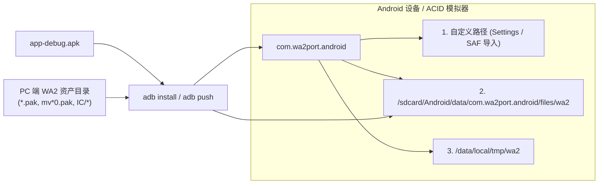

# 构建、测试与部署指南 (Build, Test & Deploy)

本文档提供 WA2 Android 移植项目的开发环境要求、桌面端单元测试（`:core:test`）、Android 调试包构建（`:app:assembleDebug`）、定制 FFmpeg 原生库重编译流程、模拟器/真机部署方法以及常见问题排查。

---

## 1. 环境要求 (Prerequisites)

| 组件 | 版本要求 | 默认路径 / 配置说明 |
|---|---|---|
| **JDK** | **JDK 21** (JetBrains Runtime / OpenJDK 21) | `$HOME/.jdks/jdk21`（可通过环境变量 `export JAVA_HOME` 或 `~/.gradle/gradle.properties` 的 `org.gradle.java.home` 指定） |
| **Gradle** | **8.10.2** | 使用仓库自带的 `./gradlew` Wrapper，无需全局安装 |
| **Android SDK** | `compileSdk = 35`, `targetSdk = 35`, `minSdk = 26` | `$HOME/Android/Sdk`（由 `local.properties` 或 `ANDROID_HOME` 指定） |
| **Android NDK** | **27.0.12077973** | `$ANDROID_HOME/ndk/27.0.12077973`（支持 Android 15 16 KB page-size 对齐） |
| **CMake** | **3.22.1** | 由 Android Gradle Plugin 自动调用编译 `app/src/main/cpp/CMakeLists.txt` |
| **Kotlin** | **2.0.21** | 启用 `plugin.compose` 与 `plugin.serialization` |

初始化命令行环境变量：

```bash
export JAVA_HOME="$HOME/.jdks/jdk21"
export ANDROID_HOME="$HOME/Android/Sdk"
export PATH="$JAVA_HOME/bin:$ANDROID_HOME/platform-tools:$PATH"
```

---

## 2. 桌面端 `:core` 单元测试与真机资产验证

`:core` 模块是纯 JVM 库，包含针对 KCAP/LZSS/LAC 归档、TGA/BMP/.AMP 图像解码、59 段字库映射与 CK-GAL 汉化表、双语剧本对齐以及 LSCR 字节码虚拟机与引擎状态机的全套 JUnit 5 测试。

### 2.1 运行测试

测试通过系统属性 `-Dwa2.root` 或环境变量 `WA2_ROOT` 定位完整版《白色相簿2》PC 安装目录（未指定时默认回退到 `<repo>/resource/WA2`）。若路径不存在，依赖真实资产的测试会通过 `Assumptions.assumeTrue` 自动跳过。

```bash
# 使用默认资产目录运行全部 :core 测试
./gradlew :core:test

# 显式指定 PC 版游戏资产目录
./gradlew :core:test -Dwa2.root=/path/to/WA2

# 仅运行特定测试套件（例如虚拟机与引擎测试）
./gradlew :core:test --tests "com.wa2port.core.VmTest"
```

### 2.2 测试套件覆盖范围

| 测试类 | 验证内容 |
|---|---|
| `ArchiveTest` | 验证 `KCAP` 头部解析、Okumura LZSS 解压字节精确度、`csize == rawSize` 防御逻辑、`LAC\0` 音频切片读取及大小写无关路径解析。 |
| `ImageTest` | 验证 `TgaDecoder`（含 `bpp=0` 修复、预乘 Alpha 与 8-bpp 索引字库提取）、`BmpDecoder`（24/32-bpp 与 8-bpp 灰度遮罩 `maskLevels`）、`AmpLut` 双表级联公式 `T0[Tc[c]]`。 |
| `ScenarioTest` | 遍历 `script.pak` 与 `ck-gal.pak` 全部 187 个剧本，验证中日双语词条 1:1 序号对齐、CP932 控制符解析、Table B 59 段映射（7,655 格）、CK-GAL 3,602 汉字表（`748..4349`）与 `4320..4350` 错位修正表。 |
| `VmTest` | 验证 `function.fnc` 签名解析、全部 `.bnr` 剧本字节码加载、控制流（`if/elif/else` 链、`for`、`switch`）、可重入挂起/恢复（`CallOutcome.Block`）、`FB`/`F` 亮度与 `.AMP` 槽位路由，以及通过 `HeadlessRunner` 对主线剧本进行数千步无头推演。 |
| `CgGalleryTest` | 验证 `cg_cards.tsv`（`.data 0x4c01b0`）对真实安装目录的 149 张卡片（27 IC + 122 CC）/ 272 个差分变体精确匹配、9 个合成图层部件与 8 张未引用 `v*.tga` 过滤，以及 `SystemData.cgFlags` 卡片级/变体级解锁逻辑。 |
| `BgmAndReplayTest` | 验证 `SystemData.gflags`（1024 项）持久化、`BgmGallery` 全部 63 首曲目在 `BGM.PAK`/`IC/BGM.PAK` 中的解析与特殊解锁规则（#25 `BGM_021/035` 切换、#31 完整版联动解锁），以及 `SceneReplayGallery` 全部 24 个回想槽位的缩略图（`tv%06d.tga`）、`9999.bnr` + `GetReplayMode()`（op `222`）剧本分发与 `GoTitle()` 结束回归。 |

---

## 3. 构建 Android APK (`:app:assembleDebug` & `:app:assembleRelease`)

仓库中已内置预编译好的 `arm64-v8a` 与 `x86_64` 架构 FFmpeg 动态库（位于 `app/src/main/cpp/ffmpeg/<abi>/lib/`），因此克隆仓库后可直接构建 Debug 或已签名的 Release APK：

```bash
# 构建 Debug APK
./gradlew :app:assembleDebug

# 构建已签名的 Release APK（未配置 WA2_KEYSTORE_PATH 时默认使用 debug 签名以便直接安装）
./gradlew :app:assembleRelease
```

构建产物路径：

```text
app/build/outputs/apk/debug/app-debug.apk
app/build/outputs/apk/release/app-release.apk
```

---

## 4. 重新编译 FFmpeg 原生库 (`build_ffmpeg.sh`)

仅当需要修改 FFmpeg 编译选项、升级 FFmpeg 版本或调整解码器裁剪列表时，才需要运行 `app/src/main/cpp/build_ffmpeg.sh`。

### 4.1 裁剪特性与合规说明

- **版本**：FFmpeg **7.0.2**（源码自动下载并缓存于 `~/.cache/wa2port-ffmpeg/`）。
- **许可证**：纯 **LGPL v2.1+**（显式禁用 `--disable-gpl` 与 `--disable-nonfree`）。
- **最小化裁剪（`--disable-everything`）**：
  - **解复用器（Demuxer）**：仅启用 `asf`
  - **解码器（Decoders）**：仅启用 `wmv3`, `vc1`, `wmav2`, `h263`
  - **协议（Protocol）**：仅启用 `file`
  - **配套库**：`libavformat`, `libavcodec`, `libswscale`, `libswresample`, `libavutil`
- **符号自检**：脚本在编译完成后会自动使用 NDK 的 `llvm-nm -u` 检查生成的 `.so`，确保不存在任何因裁剪过度导致的未解析内部符号（如 `ff_h263_*`）。

### 4.2 执行编译

```bash
# 同时编译 arm64-v8a 和 x86_64（默认）
app/src/main/cpp/build_ffmpeg.sh

# 仅编译单一 ABI
app/src/main/cpp/build_ffmpeg.sh x86_64
```

> [!IMPORTANT]
> 根级 `.gitignore` 默认忽略 `*.so` 文件。如果重新生成并希望提交更新后的预编译库，请使用 `git add -f app/src/main/cpp/ffmpeg/<abi>/lib/*.so`。

### 4.3 原生解码器独立探针测试 (`test_probe.sh`)

在无需启动完整 Android UI 的情况下，可通过命令行探针 `wa2_movie_probe` 直接在设备/模拟器上验证 `libwa2movie.so` 对真实 `.asf` 视频的音视频解码吞吐与帧数：

```bash
app/src/main/cpp/test/test_probe.sh <adb-serial> <abi> <device-asf-path>
# 示例：
app/src/main/cpp/test/test_probe.sh localhost:27298 x86_64 \
  /sdcard/Android/data/com.wa2port.android/files/wa2/mv000.pak
```

---

## 5. 部署与资产推送 (Emulator / Device Deploy)



### 5.1 连接模拟器或真机

在 Google Cloudtop 环境下，推荐使用 ACID Android 15 (`API 35`, `x86_64`) 模拟器，或通过 `adb connect` 连接已启动的实例：

```bash
# 查看已连接设备
adb devices
```

### 5.2 安装 APK 并启动应用

```bash
# 覆盖安装 Debug APK
adb install -r app/build/outputs/apk/debug/app-debug.apk

# 启动主 Activity
adb shell am start -n com.wa2port.android/.MainActivity
```

### 5.3 推送游戏资产 (`AssetLocator` 查找顺序)

应用启动时，`AssetLocator` 会按以下优先级自动探测包含 `script.pak`（或 `fnt.pak`）的游戏根目录：

1. 用户在应用内设置的自定义路径（或通过 SAF 导入到 `files/wa2/` 的目录）；
2. 应用外部专属目录（**推荐，无需额外存储权限**）：
   `/sdcard/Android/data/com.wa2port.android/files/wa2`
3. 命令行调试临时目录：
   `/data/local/tmp/wa2`

使用 `adb push` 推送完整游戏资产到推荐路径：

```bash
DEST=/sdcard/Android/data/com.wa2port.android/files/wa2
SRC=/path/to/WA2

# 1. 创建目标目录（先启动一次应用或手动 mkdir）
adb shell mkdir -p "$DEST" "$DEST/IC"

# 2. 推送核心与汉化归档（开发快速迭代可先推这几个包即可启动游戏）
for f in script.pak ck-gal.pak fon.pak fnt.pak grp.pak bak.pak char.pak SE.pak; do
  adb push "$SRC/$f" "$DEST/$f"
done

# 3. 推送大容量音视频与 IC 归档（完整体验所需）
for f in BGM.pak VOICE.pak patch.pak mv*0.pak; do
  for p in $SRC/$f; do
    [ -f "$p" ] && adb push "$p" "$DEST/$(basename "$p")"
  done
done
adb push "$SRC/IC/." "$DEST/IC/"
```

> [!TIP]
> 在真机上，如果不想使用 `adb push`，也可以直接将 PC 版游戏目录复制到手机存储任意位置，首次打开应用进入 **Assets（资源设置）** 页面，点击选择文件夹，通过 `SafImporter` 自动导入（支持断点续传并自动跳过 `.exe`/`.dll`/`.chm` 等无关文件）。

---

## 6. 常见问题排查 (Troubleshooting)

### Q1: 构建时报错 `Unsupported class file major version` 或 Kotlin JVM target 不匹配
- **原因**：当前终端默认 `java` 版本低于 JDK 17/21。
- **解决**：确认 `export JAVA_HOME="$HOME/.jdks/jdk21"`，或在 `~/.gradle/gradle.properties` 中配置 `org.gradle.java.home` 指向 JDK 21 目录。可通过 `./gradlew --version` 验证 Gradle Daemon 实际运行的 JVM 版本。

### Q2: `:core:test` 全部显示 `SKIPPED`
- **原因**：未找到默认路径 `resource/WA2` 下的真实游戏包，触发了 `Assumptions.assumeTrue(TestAssets.available)`。
- **解决**：通过 `-Dwa2.root=/your/path/to/WA2` 传入包含 `script.pak` 和 `fnt.pak` 的目录。

### Q3: 应用启动后进入资源向导页（提示缺少 `script.pak` 或 `fnt.pak`）
- **原因**：`AssetLocator` 未在默认路径下检测到必需的归档文件，或推送到了 `/data/local/tmp/wa2` 但文件权限不可读。
- **解决**：
  - 若推送到 `/sdcard/Android/data/com.wa2port.android/files/wa2`，检查文件名是否正确（支持大小写无关，但需直接在 `wa2/` 根目录下而非多套一层子目录）；
  - 若推送到 `/data/local/tmp/wa2`，执行 `adb shell chmod -R a+rX /data/local/tmp/wa2` 确保应用 UID 拥有读取权限。

### Q4: 中文文本显示为空白或个别汉字错位
- **原因**：缺少汉化包 `ck-gal.pak` 或缺少包含汉化扩展格 `748..4349`（共 3,602 个汉字格）的汉化字库归档 `fon.pak`。
- **解决**：确保使用的是搭载 CK-GAL 汉化补丁的资源目录（同时包含根目录下的 `ck-gal.pak`、`fon.pak` 以及日文字库 `fnt.pak` / `IC/fnt.pak`）。引擎优先从 `fon.pak` 读取 `本体80.tga` 与 `袋影80.tga`（回退至 `fnt.pak`），以确保全部 3,602 个汉化扩展汉字格与日文假名/符号格完整可用。

### Q5: 视频播放黑屏或报错 `UnsatisfiedLinkError: dlopen failed`
- **原因**：对应 ABI（`arm64-v8a` 或 `x86_64`）下的预编译 FFmpeg `.so` 缺失，或 `mv*0.pak` 视频文件未推送到游戏目录。
- **解决**：
  - 检查 `app/src/main/cpp/ffmpeg/<abi>/lib/` 下是否存在 `libavcodec.so`、`libavformat.so`、`libavutil.so`、`libswresample.so`、`libswscale.so`；若缺失，运行 `app/src/main/cpp/build_ffmpeg.sh` 重新生成；
  - 确认视频文件 `mv000.pak`、`mv010.pak`、`mv020.pak` 等位于 `<wa2_root>/` 或 `<wa2_root>/IC/`（如 `IC/mv100.pak`）。
