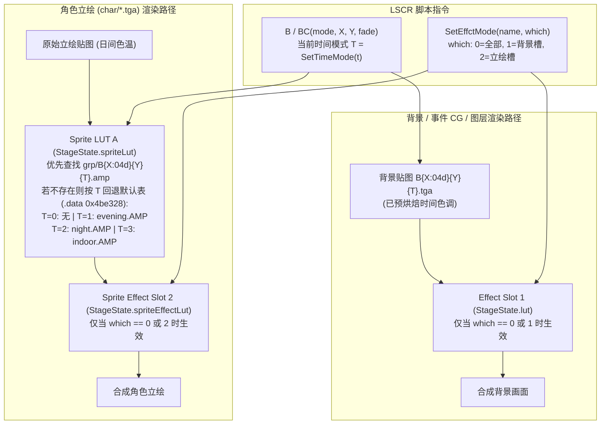

# White Album 2 (`WA2.exe` + CK-GAL 汉化补丁) 逆向工程规范

本文档汇总了对 PC 版《白色相簿2》（White Album 2 Complete Set v1.01，结合澄空学园 CK-GAL 简体中文汉化补丁）执行文件 `WA2.exe` / `WA2_chs.exe` 及全部 49 个资源归档文件的逆向工程成果。文中的所有偏移量、数据结构、计算公式与特殊边界情况均已通过静态反汇编（Ghidra x86）与全量语料库自动化测试（`:core:test`）的双重验证。

---

## 1. 引擎识别与 `WA2.exe` vs `WA2_chs.exe` 二进制差异

### 1.1 引擎血统与技术特征
PC 版《白色相簿2》采用 **Leaf / Aquaplus 自研 Direct3D 9 AVG 引擎**（代码脉络源自 `TtT` = *Tears to Tiara*，与 *ToHeart2 AD* 同源；PDB 路径为 `i:\prog\WA2_cc\_D3DD\Release\TtT.pdb`，链接时间戳 `2011-12-27`），而非 KiriKiri 或主机移植版使用的 AdvHD。

* **图形与音频依赖**：导入 `d3d9.dll`、`d3dx9_41.dll`（DirectX March 2009）、`DSOUND.dll`、`DDRAW.dll`、`WINMM.dll`、`MSACM32.dll`；静态链接 `Xiph.Org libVorbis I 20030909` 解码 OGG 音频；视频通过 Windows DirectShow / WMF 播放。
* **资源加载优先级（Loader Search Order）**：
  引擎按以下顺序查找 `<dir>\<file>`（対応 [`Wa2Assets.kt`](../core/src/main/kotlin/com/wa2port/core/archive/Wa2Assets.kt)）：
  1. 散文件目录：`<root>/<dir>/<file>`（如 CK-GAL 汉化补丁提供的 32 个 `grp/sys_*.tga` UI 贴图覆盖文件）
  2. 补丁归档：`<root>/patch.pak`（可选覆盖包）
  3. 主目录归档：`<root>/<dir>.pak`（CC / Coda 及最新剧本）
  4. 序章子目录归档：`<root>/IC/<dir>.pak`（Initial Chapter 序章资源回退）
  > [!IMPORTANT]
  > Windows 文件系统大小写不敏感，而原版安装目录混用了 `BGM.PAK`、`bak.pak`、`B100400.tga` 与 `b100400.tga`。Android 文件系统大小写敏感，因此 [`Wa2Assets`](../core/src/main/kotlin/com/wa2port/core/archive/Wa2Assets.kt) 对所有目录与包内条目均统一转换为小写建立索引。

### 1.2 `WA2.exe` 与 `WA2_chs.exe` 逐字节对比
对日文原版 `WA2.exe` 与澄空学园汉化版 `WA2_chs.exe`（各 1.2 MB）进行逐字节比对，共有 **158 处差异区间**：
* **`.text` 代码段 100% 逐字节完全一致**：CK-GAL 汉化补丁**没有任何代码 Hook 或指令修改**，完全复用了日文原版的 Shift-JIS 字符寻址与渲染逻辑。
* **PE Header（4 处）与 `.rsrc` 资源段（42 处）**：汉化了 Win32 窗口菜单、对话框与版本信息。
* **`.rdata` 只读数据段（112 处）**：
  * `0x0a1b60`：将剧本归档名从 `"script"` 替换为 `"ck-gal"`（从而加载 `ck-gal.pak` 而非 `script.pak`）。
  * `0x0a1bc1`：将字库归档名从 `"fnt"` 替换为 `"fon"`（从而加载 `fon.pak` 而非 `fnt.pak`）。
  * Win32 调试/报错弹窗字符串重编码为 GBK（如 `找不到SE文件[%04d].wav`），游戏内嵌 UI 字符串（读档确认、曲名）重编码为游戏内伪 Shift-JIS 字库编码。

---

## 2. 归档容器与压缩算法

### 2.1 `KCAP` 归档格式 (`*.pak`)
用于存储剧本、字库、背景、立绘、CG 与特效文件（`script.pak`、`ck-gal.pak`、`fnt.pak`、`fon.pak`、`bak.pak`、`char.pak`、`grp.pak` 及其 `IC/` 副本）。解析实现见 [`KcapArchive.kt`](../core/src/main/kotlin/com/wa2port/core/archive/KcapArchive.kt)。

#### 文件头（16 字节，Little-Endian）
| 偏移 | 类型 | 字段名 | 说明 |
|---|---|---|---|
| `0x00` | `char[4]` | `magic` | 固定为 `"KCAP"` (`4B 43 41 50`) |
| `0x04` | `u32` | `unk1` | 未知版本号/标志位 |
| `0x08` | `u32` | `unk2` | 未知字段 |
| `0x0C` | `u32` | `count` | 索引表条目总数 |

#### 索引表条目（紧随文件头，`count × 44` 字节）
| 偏移 | 类型 | 字段名 | 说明 |
|---|---|---|---|
| `0x00` | `u32` | `flag` | `0` = 未压缩直存（Stored）；`1` = Okumura LZSS 压缩；`0xCCCCCCCC` = 目录项或开发残留垃圾（如 `vssver2.scc`、`Thumbs.db`、`新しいフォルダ`），应忽略 |
| `0x04` | `char[24]` | `name` | CP932 编码文件名，以 `\0` 结尾 |
| `0x1C` | `u64` | `fileTime` | Windows `FILETIME` 时间戳 |
| `0x24` | `u32` | `offset` | 数据载荷在归档文件中的绝对字节偏移 |
| `0x28` | `u32` | `size` | 数据载荷在归档文件中的字节长度（含 8 字节压缩头） |

#### 压缩载荷头与 CK-GAL 重打包 `csize` 缺陷
当 `flag == 1` 时，`file[offset : offset + size]` 前 8 个字节为压缩头：
```
0x00: u32 csize   // 标称压缩尺寸
0x04: u32 usize   // 解压后原始字节尺寸 (Uncompressed Size)
0x08: u8  data[]  // Okumura LZSS 压缩字节流，长度为 size - 8
```

> [!WARNING]
> **CK-GAL 重打包器的 `csize` 少 8 字节缺陷**：
> Leaf 官方打包工具生成的 `KCAP`（如 `script.pak` 中全部 377 个压缩条目）写入的 `csize == entry.size`（包含 8 字节头本身）；但 CK-GAL 汉化组重打包 `ck-gal.pak` 中的 181 个 `.txt` 剧本文件时，写入了 `csize == entry.size - 8`。
> 若解压器信任 `csize` 并按 `csize - 8` 截断输入流，会导致所有中文剧本末尾**静默丢失最后 8 个字节**（例如 `1001.txt` 末尾用于跳转到下一章的 `,1002,` Token 被截断）。因此必须始终将 `raw[8 : entry.size]` 完整送入解压器，并仅以产出 `usize` 字节作为终止条件。

### 2.2 Okumura LZSS 解压算法
`KCAP` 使用经典的 **Okumura 4 KiB 滑动窗口 LZSS** 算法（实现见 [`OkumuraLzss.kt`](../core/src/main/kotlin/com/wa2port/core/archive/OkumuraLzss.kt)）：
* **环形缓冲区（Ring Buffer）**：容量 `RING_SIZE = 0x1000`（4096 字节），初始全部填充 `0x00`。
* **初始写入指针**：`r = 0xFEE`（4078）。
* **控制字节（Flags Byte）**：每次从输入流读取 1 个字节 `flags`，从最低位（LSB, bit 0）到最高位（MSB, bit 7）依次处理 8 个项目：
  * **Bit = `1`（字面量 Literal）**：从输入流读取 1 字节 `c`，直接写入输出流，同时写入 `ring[r]` 并令 `r = (r + 1) & 0xFFF`。
  * **Bit = `0`（回溯引用 Back-Reference）**：从输入流读取 2 字节 `lo` 和 `hi`：
    * 环形缓冲区起始位置：`pos = lo | ((hi & 0xF0) << 4)`（12-bit 绝对索引 `0..4095`）
    * 拷贝长度：`len = (hi & 0x0F) + 3`（范围 `3..18` 字节）
    * 循环 `len` 次（且输出未满 `usize`）：取 `c = ring[pos]`，写入输出流与 `ring[r]`，同时递增 `pos = (pos + 1) & 0xFFF` 和 `r = (r + 1) & 0xFFF`。

### 2.3 `LAC\0` 音频归档格式 (`BGM.PAK` / `SE.PAK` / `VOICE.PAK`)
所有音频包（含根目录与 `IC/` 目录下的 6 个归档）均采用无压缩的 `LAC\0` 容器（实现见 [`LacArchive.kt`](../core/src/main/kotlin/com/wa2port/core/archive/LacArchive.kt)）。

#### 文件结构
* **文件头（8 字节）**：
  * `0x00`: `char[4]` 魔数 `"LAC\0"` (`4C 41 43 00`)
  * `0x04`: `u32 count` 条目数量
* **索引表条目（`count × 40` 字节）**：
  * `0x00`: `u8 nameRaw[32]` — 文件名每个有效字节均经过 **`XOR 0xFF`** 混淆，未使用的尾部填充字节为**原始 `0x00`**。
    > [!NOTE]
    > 解码文件名时，必须**先在原始字节上查找第一个 `0x00` 确定名字长度 `n`**（因为 `0x00 XOR 0xFF` 会变成 `0xFF`），然后仅对前 `n` 个字节执行 `b XOR 0xFF` 并按 CP932 解码。
  * `0x20`: `u32 size` — 音频载荷字节大小
  * `0x24`: `u32 offset` — 音频载荷在归档文件中的绝对偏移

由于载荷完全未压缩且连续存放（BGM 为 48 kHz 立体声 OGG Vorbis，共 108+57 首；Voice 为 48 kHz 单声道 OGG Vorbis，共 38,736+7,271 条；SE 为 22.05 kHz 16-bit 单声道 PCM WAV 及少量 OGG，共 1,132+830 条），Android 端无需解压提取，可直接通过 `FileSlice(file, offset, length)` 交由 `MediaPlayer.setDataSource(fd, offset, length)` 零拷贝流式播放。

---

## 3. 图像格式、调色查找表 (`.AMP`) 与屏幕亮度 (`FB`/`F`)

### 3.1 TGA 图像与立绘 `bpp = 0` / 预乘 Alpha 陷阱
游戏中的背景（`bak.pak`）、角色立绘（`char.pak`）、事件 CG 与 UI（`grp.pak`）及字库图集（`fnt.pak` / `fon.pak`）均为 TGA 格式（实现见 [`TgaDecoder.kt`](../core/src/main/kotlin/com/wa2port/core/image/TgaDecoder.kt)）：

1. **`char.pak` 的 `bpp = 0` 头部缺陷**：
   在 `char.pak` 的 1,292 张角色立绘中，有 **1,097 张**的 18 字节 TGA 头部偏移 `0x10` 处的像素位深字段 `bpp` 被写成了 **`0`**（标准 TGA 解码器会直接报错拒绝）。实际像素格式为未压缩 32-bpp BGRA（Type 2，Bottom-Up 原点）。解码器在遇到 `bpp == 0` 时，必须根据载荷字节数反推真实位深：
   ```kotlin
   bpp = ((data.size - pos).toLong() * 8 / (width * height)).toInt() // >= 32 -> 32-bpp
   ```
2. **非零透明底色（`α = 2`）与预乘 Alpha（Premultiplied Alpha）**：
   立绘存储的是未预乘的 Straight Alpha，但美术资产中“全透明背景区域”的 Alpha 值并不统一：例如 `aco001001.tga` 背景为 `α = 0`，而 `kaz027100.tga` 背景的 42.7 万个像素全部为 **`α = 2, RGB = (255, 255, 255)`**！
   * 如果渲染器做 `alpha == 0` 裁剪测试或直接按未预乘贴图过滤，立绘周围会出现明显的白色矩形边框。
   * 正确做法：在加载解码时立即执行预乘 Alpha：
     $$R' = \lfloor (R \times \alpha + 127) / 255 \rfloor,\quad G' = \lfloor (G \times \alpha + 127) / 255 \rfloor,\quad B' = \lfloor (B \times \alpha + 127) / 255 \rfloor$$
     此时 `(255, 255, 255, α=2)` 被预乘为 `(2, 2, 2, 2)`，在 `ONE, ONE_MINUS_SRC_ALPHA` 混合下肉眼完全不可见。
3. **8-bpp 调色板字库图集（`decodeIndexed`）**：
   `fnt.pak` 和 `fon.pak` 中的 `本体80.tga` / `袋影80.tga` 分辨率高达 `3200×3840`（Type 1，8-bpp 索引色，调色板 RGB 全白，Alpha 通道记录覆盖率）。若直接展开为 `ARGB_8888` 每个图集将占用 49.2 MB 内存；通过 `TgaDecoder.decodeIndexed` 提取调色板 Alpha 转存为 Android `Bitmap.Config.ALPHA_8`，每个图集仅占 **12.3 MB**，且支持任意颜色着色绘制。

### 3.2 BMP 过渡遮罩 (`f0%03d.bmp`)
`grp.pak` 中包含 91 张规则溶解遮罩 `f0000.bmp`–`f0113.bmp`（部分编号空缺）：其中 78 张为 `1280×720` 8-bpp 灰度调色板 BMP（含 `BI_RGB` 与 `BI_RLE8` 压缩），10 张为 `1280×720` 32-bpp BMP，3 张为小尺寸 UI 位图。[`BmpDecoder.kt`](../core/src/main/kotlin/com/wa2port/core/image/BmpDecoder.kt) 将其解析为灰度值 `0..255`，用于驱动 `TransitionKind.MASK` 渐变过渡。

### 3.3 `.AMP` 调色查找表（LUT）与双槽位路由规则
`grp.pak` 中的 `.AMP` 文件是色调映射曲线表（对应 `WA2.exe` 像素循环 `0x438cad`–`0x438e2c`，实现见 [`AmpLut.kt`](../core/src/main/kotlin/com/wa2port/core/image/AmpLut.kt)）。

#### 文件尺寸与查表公式
`.AMP` 文件大小必为 256 字节的整数倍，引擎根据表数量分支处理：
* **1280 字节（5 × 256B，如 `sepia.AMP`、`night.AMP`、`indoor.AMP`、`B*.amp`）**：
  包含 5 张 256 字节表 `T0..T4`。其中 **`T0`（偏移 `0x000`）是主曲线（Master Curve），在通道曲线之后应用**；`T1`（`0x100`）为 Red 曲线，`T2`（`0x200`）为 Green 曲线，`T3`（`0x300`）为 Blue 曲线，`T4`（`0x400`）未使用。
  对每个通道 $c \in \{R, G, B\}$，等效查找公式为：
  $$c_{\text{graded}} = T_0\big[\,T_c[c]\,\big]$$
* **768 字节（3 × 256B，如 `evening.AMP`）**：
  无主曲线，`T0 = R`，`T1 = G`，`T2 = B`，即 $c_{\text{graded}} = T_c[c]$。
* **256 字节（1 × 256B，如 `nega.AMP`、`rev*.AMP`）**：
  仅含单张主曲线 `T0`，三通道共用 $c_{\text{graded}} = T_0[c]$。

#### Alpha 边缘混合规则
在 Straight Alpha 像素 `(R, G, B, a)` 上应用 LUT 时：
* 若 `a == 0`（完全透明像素）：**直接跳过**，绝不能修改透明像素底色。
* 若 `a == 255`（完全不透明像素）：直接输出 `c_graded`。
* 若 `0 < a < 255`（半透明抗锯齿边缘）：按 Alpha 比例在原色与调色结果之间线性混合：
  $$c' = \big(c_{\text{graded}} \times a + c \times (255 - a)\big) \gg 8$$

#### 背景与立绘的 LUT 路由规则（`WA2.exe` `0x415cba`）
> [!IMPORTANT]
> **背景图与角色立绘使用完全不同的 LUT 通道，绝不可将场景时间 LUT 叠加到背景图上！**



* `grp.pak` 中仅存在 7 个专属背景 `.amp` 文件：`b000100.amp`、`b000200.amp`、`b202501.amp`、`b202511.amp`、`b205001.amp`、`b207901.amp`、`b209611.amp`。其余所有场景（例如 `1002` 黄昏场景 `B100401.tga`，`T = 1`）立绘均自动回退使用 `.data 0x4be328` 表定义的默认时间 LUT（`evening.AMP`），而背景 `B100401.tga` 保持原图输出，避免双重套用曲线导致画面发灰褪色。

### 3.4 `FB` / `F` 屏幕亮度调制公式（非半透明遮罩）
脚本指令 `FB(time, r, g, b)`（op 153，处理器 `0x4553a0`）与 `F(t1, t2, r, g, b)`（op 152，处理器 `0x455350`）共同调用底层函数 `0x401de0`，由每帧 Tick 函数 `0x40d240` / `0x40d25f` 更新当前 RGB 状态（`0x521864..0x52186c`，初始值为 `128, 128, 128`），并由 `0x43b290` 写入舞台图层（图层 ID `0x371`、`0x409`、`0x40a`）四个顶点的 D3D 漫反射/高光颜色（`COLOROP = MODULATE`）。

* **核心定性**：`FB` 和 `F` 是**舞台图层的通道亮度调制（Brightness Modulation + Additive Offset）**，而不是 Alpha 半透明色块覆盖！`LFScriptFuncEx.fnc` 中 `FB` 的默认参数为 `(time=-1, r=128, g=128, b=128)`，其中 **`(128, 128, 128)`（`0x808080`）代表 100% 原始亮度的中性状态（无任何效果）**。
* **逐通道数学公式（`0x43b290`）**：
  对于每个颜色通道参数 $v \in [0, 255]$，设输入像素通道值为 $C_{\text{in}} \in [0, 255]$：
  $$\text{mul}(v) = \min\!\left(1.0,\; \frac{2v}{255}\right), \qquad \text{add}(v) = \text{clamp}(2v - 256,\; 0,\; 255)$$
  $$C_{\text{out}} = \text{clamp}\big(C_{\text{in}} \times \text{mul}(v) + \text{add}(v),\; 0,\; 255\big)$$
  * 当 $v = 0$ 时：$\text{mul} = 0, \text{add} = 0 \implies C_{\text{out}} = 0$（纯黑，`FB(0, 0, 0, 0)` 即瞬间黑屏）。
  * 当 $v = 128$ 时：$\text{mul} = 1, \text{add} = 0 \implies C_{\text{out}} = C_{\text{in}}$（完全中性，`StageView.tintFilter` 直接返回 `null`）。
  * 当 $v = 255$ 时：$\text{mul} = 1, \text{add} = 254 \implies C_{\text{out}} = 255$（纯白闪光）。
* **时序行为**：
  * `FB(time, r, g, b)`（`mode = 0`）：在 `time` 帧（60 fps；`time <= 0` 为立即切换）内从当前 RGB 线性插值到 `(r, g, b)` 并**保持该状态**。
  * `F(t1, t2, r, g, b)`（`mode = 1`）：在 `t1` 帧内线性插值到 `(r, g, b)`，到达后自动将目标重置为中性色 `(128, 128, 128)` 并在 `t2` 帧内线性衰减恢复。
  * **作用范围**：仅作用于舞台画面（背景、立绘、图层、CG），**绝不作用于对话框与文字 UI**。

---

## 4. 字库图集 (`fnt.pak` / `fon.pak`) 与中日编码映射体系

### 4.1 字库图集布局
`fnt.pak`（日文原版）与 `fon.pak`（CK-GAL 汉化版）具有完全相同的网格拓扑：
* **每行固定 80 格（`CELLS_PER_ROW = 80`）**，共 96 行，总容量 `80 × 96 = 7,680` 格，其中有效映射格数为 **`7,655` 格（索引 `0..7654`）**。
* 给定格号 `cell`，其在图集中的像素左上角坐标为：
  $$x = (\text{cell} \bmod 80) \times \text{cellSize}, \qquad y = \lfloor \text{cell} / 80 \rfloor \times \text{cellSize}$$
* 包含两套字号图集（8-bpp 索引色 TGA）：
  1. **40 px 主图集**：`本体80.tga`（字芯）与 `袋影80.tga`（描边阴影），尺寸 `3200×3840`。每个 40×40 格内实际字面（em box）为从偏移 `(4, 4)` 开始的 `30×30` 区域（`CELL_EM = 0.75f`，`CELL_ORIGIN = 0.1f`）。
  2. **24 px 小字图集**：`14pt本体.tga` 与 `14pt袋.tga`，尺寸 `1920×2304`。

### 4.2 `WA2.exe` 59 段编码映射表（`0x401050` / `.rdata 0x4a14b8`）
引擎通过函数 `0x401050(code16, flag)` 将字符编码转换为图集格号 `cell`（实现见 [`Wa2FontMap.kt`](../core/src/main/kotlin/com/wa2port/core/text/Wa2FontMap.kt)）：
* **码值 `code16` 构造规则**：
  * **双字节字符（DBCS）**：文本行进器（`0x44db80`）识别首字节（Lead Byte）范围为 `0x81–0x9F`、`0xE0–0xEA`、`0xF0`（及 IBM 扩展 `0xFA–0xFC`），与紧随其后的尾字节（Trail Byte）组合为大端 16 位整数：`code16 = (lead << 8) | trail`。**注意：尾字节 `0x7F` 在本引擎中是合法尾字节！**
  * **单字节字符（SBCS）**：若 `b < 0x80`（ASCII），`code16 = b`；若 `b >= 0x80`（半角假名 `0xB1..0xDD`），调用方将其符号扩展为 **`code16 = 0xFF00 | b`**（即 `0xFFB1..0xFFDD`）。
* **双表机制**：当 `flag == 0` 时使用 `.rdata 0x4a1420` 处的 Table A（仅含前 36 段、3,728 格，止于 JIS 第一水准汉字）；但全程序唯一的渲染调用点 `0x4463e4` 固定传入 **`flag = 1`**，使用 **`.rdata 0x4a14b8`（文件偏移 `0x0a04b8`）处的完整 59 段表（Table B，共 7,655 格）**。未命中任何区间时返回累计总数 `7655`（即无字形，不绘制）。

#### 完整 59 段区间映射表（Table B）
| 段号 `#` | `code16` 范围 (`lo–hi`) | 图集格号 (`cells`) | 格数 | 字符内容 / 锚点说明 |
|---|---|---|---|---|
| 0 | `0x0020–0x007D` | `0–93` | 94 | 半角 ASCII 空格 `!` .. `}`（不含 `~` `0x7E`） |
| 1 | `0xFFB1–0xFFDD` | `94–138` | 45 | 半角片假名 `ｱ` (`0xB1`) .. `ﾝ` (`0xDD`) |
| 2 | `0x8140–0x81AC` | `139–247` | 109 | 全角空格 `139` (`0x8140`)、`、` `140` (`0x8141`)、标点符号 |
| 3 | `0x81B8–0x81BF` | `248–255` | 8 | 集合与逻辑符号 |
| 4 | `0x81C8–0x81CE` | `256–262` | 7 | 逻辑与数学符号 |
| 5 | `0x81DA–0x81FC` | `263–297` | 35 | 数学、箭头与几何符号 |
| 6 | `0x824F–0x8258` | `298–307` | 10 | 全角数字 `０`–`９` |
| 7 | `0x8260–0x8279` | `308–333` | 26 | 全角大写英文字母 `Ａ`–`Ｚ` |
| 8 | `0x8281–0x829A` | `334–359` | 26 | 全角小写英文字母 `ａ`–`ｚ` |
| 9 | `0x829F–0x82F1` | `360–442` | 83 | 平假名 `ぁ`–`ん` |
| 10 | `0x8340–0x8396` | `443–529` | 87 | 片假名 `ァ`–`ヶ`（**含 `0x837F`**） |
| 11 | `0x839F–0x83B6` | `530–553` | 24 | 大写希腊字母 `Α`–`Ω` |
| 12 | `0x83BF–0x83D6` | `554–577` | 24 | 小写希腊字母 `α`–`ω` |
| 13 | `0x8440–0x8460` | `578–610` | 33 | 大写西里尔字母 `А`–`Я` |
| 14 | `0x8470–0x8491` | `611–644` | 34 | 小写西里尔字母 `а`–`я`（**含 `0x847F`**） |
| 15 | `0x849F–0x84BE` | `645–676` | 32 | 制表符边框线 |
| 16 | `0x8740–0x875D` | `677–706` | 30 | NEC 特殊字符 `①` (`677`)–`⑳`、罗马数字 `Ⅰ`–`Ⅹ` |
| 17 | `0x875F–0x8775` | `707–729` | 23 | NEC 单位与缩写符号（`㍉`、`㌔`、`㈱` 等） |
| 18 | `0x877E–0x878F` | `730–747` | 18 | NEC 数学与带圈符号（**含 `0x877F`**） |
| 19 | `0x889F–0x88FC` | `748–841` | 94 | JIS 第一水准汉字首行：锚点 **`0x889F` → `748`（JP `亜` / CN `一`）** |
| 20–34 | `0x8940–0x89FC` … `0x9740–0x97FC` | `842–3676` | 15×189 = 2835 | 首字节 `0x89`..`0x97` 共 15 行，每行 `0x40..0xFC` 连续 189 格（**均含 `0x??7F`**）。锚点：`0x897F` → `905`（CN `使`），`0x8BC2` → `1350`（JP `仰`），`0x8BC5` → `1353`（JP `暁` / CN `啊`） |
| 35 | `0x9840–0x9872` | `3677–3727` | 51 | JIS 第一水准末尾：锚点 **`0x9872` → `3727`（JP `腕`）** |
| 36 | `0x989F–0x98FC` | `3728–3821` | 94 | JIS 第二水准起始（跳过 `0x9873–0x989E`）：锚点 **`0x989F` → `3728`（JP `弌`）** |
| 37–43 | `0x9940–0x99FC` … `0x9F40–0x9FFC` | `3822–5144` | 7×189 = 1323 | 首字节 `0x99`..`0x9F` 共 7 行，每行 189 格（CK-GAL 汉化字库止于格 `4349`） |
| 44–53 | `0xE040–0xE0FC` … `0xE940–0xE9FC` | `5145–7034` | 10×189 = 1890 | 首字节 `0xE0`..`0xE9` 共 10 行，每行 189 格 |
| 54 | `0xEA40–0xEAA4` | `7035–7135` | 101 | JIS 第二水准末尾：锚点 **`0xEAA4` → `7135`（JP `熙`）** |
| 55 | `0xF040–0xF0C0` | `7136–7264` | 129 | 外字区（仅 `0xF07F` → `7199` 绘有 `・` 占位符，其余为空白） |
| 56 | `0xFA40–0xFAFC` | `7265–7453` | 189 | IBM 扩展字符首行（`0xFA40` → `7265` `ⅰ`） |
| 57 | `0xFB40–0xFBFC` | `7454–7642` | 189 | IBM 扩展字符次行 |
| 58 | `0xFC40–0xFC4B` | `7643–7654` | 12 | IBM 扩展字符末行：锚点 **`0xFC4B` → `7654`（`黑`）** |

### 4.3 CK-GAL 汉化字库区间（`748–4349`）、`0x7F` 尾字节与错位修复
通过对 `fnt.pak` 与 `fon.pak` 进行二值化逐格比对与梯度方向特征模板匹配（结合单调 Unicode 动态规划，见 [`CnCellTable`](../core/src/main/kotlin/com/wa2port/core/text/BilingualText.kt) 与 [`cn_cells.tsv`](../core/src/main/resources/wa2/cn_cells.tsv)），确定了 CK-GAL 字库的精确构造：

1. **仅替换了格 `748–4349`（共 3,602 个汉字）**：
   * **格 `748–4298`（3,551 格）**：按 Unicode 码点升序排列的简体/日体汉字（起点 `748` = `一` `U+4E00`；包含部分日文汉字字形如 `増`/`対`/`圧`，以及两个未按顺序排列的残留日文汉字 `918 煙`、`2814 湯`）。
   * **格 `4299–4349`（51 格）**：汉化组追加的未排序生僻字/符号（其中 `4299` 为粗体破折号 `—` `U+2014`）。
   * **格 `0–747` 与 `4350–7654`**：与日文 `fnt.pak` **逐像素 100% 相同**，保留原 CP932 标点、假名、英数与符号含义。
2. **尾字节 `0x7F` 的广泛使用**：
   在日文 `fnt.pak` 中，所有 `0x??7F` 格（如 `0x817F`、`0x897F` = 格 `905`）均只绘有中点占位符 `・`（因为标准 CP932 中 `0x7F` DEL 不是合法尾字节）。但 CK-GAL 在生成 `fon.pak` 时，将汉字按连续格号填入，导致 `0x??7F` 对应的格子里填入了常用汉字（如 **`0x897F` → 格 `905` = `使`**）！在 `ck-gal.pak` 全剧本中，共有 **18 种不同的 `0x??7F` 编码、累计出现 6,564 次**。因此，解析中文剧本绝对不能经过标准 `Shift_JIS` / `CP932` 字符集转换，必须直接按首字节规则切分并查 59 段表。
3. **CK-GAL 原版补丁的 `4320–4350` 错位一格 Bug（Off-by-One Bug）与修复**：
   在 `ck-gal.pak` 文本中，凡是引用格 `4320..4350` 的字符，在原版 PC 汉化补丁中均显示成了**前一个格子的错误汉字**（语料库上下文铁证：`抬杠`、`涟漪`、`杂糅`、`租赁`、`白头偕老`、`骨鲠在喉`、`罅隙` 等词在原版 PC 上均显示错字）。
   * 原因：CK-GAL 编码工具在格 `4320` 处多算了一格，使得文本码 `4320` 实际想表达 `杠`（位于图集格 `4308`），而文本码 `k ∈ [4321, 4350]` 实际想表达图集格 `k - 1`（例如文本码 `4350` 对应图集格 `4349` 的 `罅`）。
   * 本移植版在 [`core/src/main/resources/wa2/cn_render_remap.tsv`](../core/src/main/resources/wa2/cn_render_remap.tsv) 中内置了这 31 项重映射（`4320 → 4308`，`4321..4350 → k-1`），通过 `CnCellTable.atlasCell(cell)` 在渲染时自动修正了原版汉化补丁的错字 Bug。
4. **7 个游离单字节错字（Stray Single Bytes）**：
   `ck-gal.pak` 文本中存在 7 处汉化录入时遗留的非法单字节：`0x7E`（3 处：场景 `2407`、`3001`、`3010`）、`0x09`（2 处：`2009`、`2504`）、`0x1E`（1 处：`2322`）、`0x7F`（1 处：`2411`）。它们不在 59 段表内（`Wa2FontMap.cellOf` 返回 `-1`，原版引擎返回 `7655` 不绘制），解码器与渲染器直接忽略跳过，绝不抛出异常。

---

## 5. 剧本 `.txt` 词法语法与中日 1:1 严格对齐

### 5.1 `.txt` 逗号分词流与内嵌标记语法
每个场景拥有同名的 `NNNN.txt`（文本词流）与 `NNNN.bnr`（字节码）。`NNNN.txt` 是以 ASCII 逗号 `0x2C` (`,`) 分隔的 Token 数组（实现见 [`ScenarioStore.kt`](../core/src/main/kotlin/com/wa2port/core/script/ScenarioStore.kt) 与 [`BilingualText.kt`](../core/src/main/kotlin/com/wa2port/core/text/BilingualText.kt)）：
* **为什么可以直接按 `0x2C` 字节切分**：Shift-JIS 双字节字符的尾字节范围为 `0x40..0xFC`，永远不会等于 `0x2C`，因此无需区分多字节状态即可安全按 `0x2C` 切分 Token。
* **多字节安全的标记解析（`ScenarioTextParser`）**：
  由于 Shift-JIS 尾字节可能等于 `0x5C` (`\`, 如 `ソ` `0x835C`、`表` `0x955C`) 或 `0x7C` (`|`, 如 `ポ` `0x837C`)，解析器严格在**字符边界（Lead Position）**识别以下控制标记：
  * `\n`（或 CK-GAL 偶发的双反斜杠 `\\n`）：显式换行（`TextItem.NewLine`）。
  * `\k`（或 `\\k`）：同一条消息内的按键分页等待标记（`TextItem.PageBreak`）。
  * `<R汉字|注音>`：Ruby 振假名注音结构（`TextItem.Ruby(base, reading)`，如 `<R空港|ここ>` / `<R机场|这里>`）。
  * `<Wn>` / `<wn>`：打字机等待延时指令（`TextItem.Wait`）。
  * `<Fnn ...>` / `<Sn ...>`：字号/样式块（可嵌套 `<R...>` 或 `<W...>`），例如 `<F14「小声」>` 或 `<F16...>` 表示低声细语，渲染器以 `smallScale = 0.8f` 缩小字号并底部对齐基线绘制。

### 5.2 中日双语 1:1 严格对齐证明
对 `script.pak`（JP）与 `ck-gal.pak`（CN）全部 379 个文件进行全量校验（见 `ScenarioTest`）：
1. **192 个非 `.txt` 文件（187 个 `.bnr` 字节码、`Global.vrb`、`GFLAG.dat`、2 个 `.fnc`、`GlobalDebug.dat`）在两个包中逐字节 100% 完全一致**。
2. **全部 187 对 `.txt` 剧本文件的逗号切分 Token 数量在日文包与中文包中 100% 完全相等（共计 118,908 个 Token，0 偏差）**。
3. `.bnr` 字节码中的所有文本引用指令 `(3, X)` 均通过同一个 Token 序号 `X` 寻址 `NNNN.txt`。因此，**日文第 `X` 号 Token 与中文第 `X` 号 Token 在结构上天然保证 1:1 精确对齐**，无需任何启发式文本匹配算法。

---

## 6. LSCR 字节码规范 (`NNNN.bnr` & `*.fnc`)

### 6.1 `.bnr` 容器结构与绝对跳转偏移
每个 `.bnr` 文件是以 32 位小端整数（`i32` / `u32` word）为单位的指令流（实现见 [`LscrProgram.kt`](../core/src/main/kotlin/com/wa2port/core/script/LscrProgram.kt)）：

```
Word 0 (0x00): 'LSCR' (0x5243534C)
Word 1 (0x04): u32 headerBytes     // 头部字节数 = 12 + 8 * labelCount
Word 2 (0x08): u32 labelCount      // 内部标签（函数入口）数量 n
Word 3..2+2n : { u32 labelId, u32 byteOffset } × n   // 标签表（labelId=0 为脚本默认入口）
Word 3+2n..  : 正式字节码 Word 流（codeOffset = headerBytes，部分分析工具将首条标签也计入头部）
EOF          : 以 (6, 30) (0, 1) 结尾
```
语料库中观测到的 `(headerBytes, labelCount)` 组合共 4 种：`(20, 1)` ×28 个文件、`(68, 7)` ×155 个文件、`(124, 14)` ×3 个文件、`(28, 2)` ×1 个文件。

> [!IMPORTANT]
> **跳转目标均为文件绝对字节偏移（Absolute File Byte Offsets）**：
> 所有控制流指令（`if`、`elif`、`for`、`switch`、`goto`）以及文件头的 `labels` 表中记录的目标地址 `target`，全部是**相对于 `.bnr` 文件开头（Offset 0）的绝对字节偏移**，对应的 `words` 数组下标直接为 `wordIndex = target / 4`（在全部 187 个剧本的 2,282 个跳转目标中，2,281 个精准落在指令边界上；唯一例外是 `2019.bnr` 中的一个 `target = 0` 空分支占位符，见 §6.4）。

### 6.2 词法项（Word Tags）
每条语句由若干后缀表达式（RPN）词法项组成，并以算符 `(6, 30)` 结束（全语料库共 303,405 条语句，0 解析错误）：

| Word 序列 | Tag 名称 | 语料库出现次数 | 语义说明 |
|---|---|---|---|
| `5, 3, int` | `PushInt` | — | 将 32 位有符号整数压入求值栈（`Value.I`） |
| `5, 4, floatBits` | `PushFloat` | — | 将 IEEE-754 32 位浮点数（按位存储在 `i32` 中）压栈（`Value.F`） |
| `1, X` | `GlobalRef` | 1,345 | 压入全局变量引用 `Value.GRef(X)`，对应 `Global.vrb` 的第 `X` 号变量（`X ∈ 0..28`） |
| `2, X` | `LocalArr` | 3,053 | 压入局部数组引用 `Value.LArr(X)`（`X ∈ 0..50`），后续必跟下标入栈与 `(6, 27)` `[]` 算符构成 `Value.LRef(X, idx)` |
| `3, X` | `TextToken` | 118,534 | 压入文本 Token 引用 `Value.Text(X)`，对应当前场景 `NNNN.txt` 的第 `X` 号 Token |
| `4, op` | `Call` | — | 调用引擎函数 `op`（见 §6.5 & §7）：从栈顶弹出参数（不足部分用 `.fnc` 默认值补齐），压入返回值 |
| `6, k` | `Operator` | — | 执行 RPN 算符 `k`（见 §6.3）；`k = 30` 表示当前语句结束 |
| `0, sub, …` | `Control` | — | 控制流指令（见 §6.4） |

### 6.3 运算符表 `(6, k)`（源自 `WA2.exe` `0x451a60` 跳转表）
若二元运算任一操作数为浮点数，则自动提升为浮点运算；逻辑与比较运算返回整数 `0` 或 `1`：

| `k` | 运算符 | 语料库频次 | 语义说明 |
|---|---|---|---|
| `0` | `=` | 1,476 | 赋值：弹出右值 `b`，弹出左值引用 `ref`，将 `b` 写入 `ref` 并压回 `b`（语句开头若检测到含赋值算符，`protectBase = 1` 保护栈底左值不被函数调用误弹） |
| `1..4` | `+=` `-=` `*=` `/=` | 62 / 1 / 0 / 0 | 复合算术赋值 |
| `5..7` | `%=` `&=` `\|=` | 0 | 复合取模/位运算赋值（语料库未使用） |
| `8` / `15` | `==` / `!=` | 129 / 0 | 相等 / 不等比较 |
| `9..12` | `<` `>` `<=` `>=` | 15 / 165 / 12 / 327 | 大小关系比较 |
| `13` / `14` | `&&` / `\|\|` | 0 / 320 | 逻辑与 / 逻辑或 |
| `16` | `+` | 14,715 | 加法（大量用于立绘编号合成 `face + base`，如 `111 + 1000`） |
| `17..20` | `-` `*` `/` `%` | 283 / 613 / 548 / 0 | 减法、乘法、除法（除零保护返回 0）、取模 |
| `21` / `22` | `&` / `\|` | 41 / 129 | 按位与 / 按位或（如 `SetWeather(4 \| 256)`） |
| `23` | 一元 `-` | 11,940 | 取负（如 `-1` 编码为 `(5,3,1)(6,23)`） |
| `24` | `!` | — | 逻辑非 |
| `25` / `26` | `++` / `--` | 12 / 0 | 后缀自增 / 自减（作用于左值引用，将原值压栈） |
| `27` | `[]` | 3,053 | 数组下标：弹出索引 `idx` 与数组 `LArr(X)`，压入元素引用 `LRef(X, idx)` |
| `30` | `;` | 303,405 | **语句结束符（End of Statement）**：清空求值栈并前进 `pc` |

### 6.4 控制流指令 `(0, sub, …)` 与 `if/elif/else` 边界处理
控制流指令长度由 `sub` 决定（见 [`LscrProgram.controlLength`](../core/src/main/kotlin/com/wa2port/core/script/LscrProgram.kt) 與 [`LscrVm.kt`](../core/src/main/kotlin/com/wa2port/core/script/LscrVm.kt)）：

| `sub` | 指令总字数 (Words) | 参数列表 | 语料库频次 | 精确执行语义 |
|---|---|---|---|---|
| `0` | 2 | 无 | 970 | **标签块入口（Label-block entry）**：无操作（No-op）。每个子标签块均以上一块的 `(0,1)` 和本块的 `(0,0)` 衔接 |
| `1` | 2 | 无 | 1,157 | **标签块结束 / 返回（Return）**：970 处位于文件中部 + 187 处位于文件末尾 = 1,157，恰好等于全语料库所有文件的 `labelCount` 总和。弹出 `callStack` 返回调用点；若栈空则进入 `WaitState.Ended` |
| `2` | 4 | `elseAddr, endAddr` | 1,152 | **`if` 头部**：记录 `condIf = [elseAddr, endAddr]`，随后求值条件表达式直至遇到 `(0, 13)`。若条件为假：当 `elseAddr != 0` 时跳往 `elseTarget(elseAddr)`（1,079 处无 else 的 `if` 其 `elseAddr == 0`，直接跳往 `endAddr`） |
| `3` | 3 | `target` | 2 | **`elif`（`else if`）头部**（仅在 `2018.bnr` 与 `2019.bnr` 中出现）：<br>1. **顺序落入 vs 条件跳入**：若前一个分支为真并顺序执行到达 `(0,3)`（`elseEntry != here`），必须直接跳往整条 `if-elif-else` 链的终点 `elseEnd[here]`（由 `LscrProgram` 预扫描沿 `elif` 链向下传递），防止穿透执行 `elif` 分支。<br>2. **条件重装填**：若由前一个分支条件为假跳入（`elseEntry == here`），将 `condIf` 重新设置为 `[0, target]` 并继续求值后续条件至 `(0, 13)`。<br>3. **`2019.bnr` 的 `target == 0` 占位符**：当 `target == 0` 时表示该 `elif` 后没有 `else` 块，为假时跳往整条链的终点 `end` |
| `4` | 2 | 无 | 72 | **`else` 标记**：若由 `then`/`elif` 分支顺序执行到达此处，查预扫描表 `elseEnd[here]` 直接跳往 `endAddr`；若由条件为假跳转至此，則 `elseTarget` 会跳过这 2 个 Word（`elseAddr + 8`）直接进入 `else` 体 |
| `5` | 6 | `endAddr, condAddr, incrAddr, bodyAddr` | 12 | **`for` 循环头部**：4 个参数均为绝对字节偏移，且恒满足 `condAddr < incrAddr < bodyAddr < endAddr`。紧随其后的语句为初始化语句（如 `L0[0] = 0`），随后进入位于 `condAddr` 的条件与步进语句 `condExpr (0, 14) stepExpr` |
| `6` | 3 | `target` | 4 | 简化条件分支（仅在开发测试脚本 `LF3.bnr` 中出现，配合 `(0, 15)`） |
| `7` | `4 + 2n` | `n, (addr, val)×n, defaultAddr` | 18 | **`switch` 头部**：记录分支表，随后求值表达式直至 `(0, 16)` |
| `8` | 2 | 无 | 48 | **`case` 标签入口**：无操作（No-op） |
| `10` | 2 | 无 | 48 | **`break`（跳出 `switch`）**：弹出 `switchStack` 栈顶并跳往 `defaultAddr`（即 `switch` 结束地址） |
| `12` | 3 | `target` | 1,010 | **无条件跳转 `goto target`**（亦用于循环回跳） |
| `13` | 2 | 无 | 1,154 | `if` / `elif` 条件表达式终止符：弹出栈顶判断真假并执行分支跳转 |
| `14` | 2 | 无 | 12 | `for` 循环条件表达式与步进表达式分隔符：弹出条件值，为真跳往 `bodyAddr`，为假跳往 `endAddr` |
| `15` | 2 | 无 | 4 | `(0, 6)` 条件终止符 |
| `16` | 2 | 无 | 18 | `switch` 表达式终止符：弹出整型值 `v`，匹配 `(addr, val)` 表跳往对应 `addr`（未命中则跳往 `defaultAddr`），同时将 `SwitchFrame(defaultAddr)` 压入 `switchStack` |

### 6.5 函数签名表 (`LFScriptFunc.fnc` & `LFScriptFuncEx.fnc`)
`script.pak` 内置两个二进制函数签名表（解析实现见 [`FunctionTable.kt`](../core/src/main/kotlin/com/wa2port/core/script/FunctionTable.kt)）：
* `LFScriptFunc.fnc`：定义基础 VM 与数学函数，Opcode `0..18`。
* `LFScriptFuncEx.fnc`：定义 AVG 引擎函数，Opcode `128..238`（在 `WA2.exe` 中通过函数指针表 `0x4c2610 + 4 * (op - 128)` 分发）。
* **单条记录二进制布局**：
  ```
  0x00: char name[32]        // CP932 函数名（NUL 后可能有残留垃圾字节）
  0x20: u8   argc            // 参数个数 (0..16)
  0x21: u8   hasDefaults     // 是否带默认值表（兼作 flags 高位 bit 0x100 阻塞标记）
  0x22: u16  pad
  0x24: u32  retType         // 返回值类型：3 = int, 4 = float
  0x28: u8   argTypes[16]    // 参数类型码：3 = int, 4 = float, 5 = string/token, 6 = any, 7 = lineIndex
  0x38: i32  defaults[argc]  // 仅当 hasDefaults != 0 时存在；值 0x80000000 表示该参数必填无默认值
  ```
  调用 `(4, op)` 时，VM 从求值栈顶弹出可用参数（不超过 `argc`），若脚本压栈的参数少于 `argc`，则自动使用 `defaults` 中的默认值补齐尾部缺省参数。

---

## 7. 引擎函数语义与资源命名规则大全

### 7.1 全量实装 Opcode 速查表
全 187 个剧本实际调用了 84 个 Opcode（其余 47 个 Opcode 在语料库中出现次数为 0，安全作为 No-op 处理）。实现见 [`LscrVm.kt`](../core/src/main/kotlin/com/wa2port/core/script/LscrVm.kt)（`0..18`）与 [`Wa2Engine.kt`](../core/src/main/kotlin/com/wa2port/core/engine/Wa2Engine.kt)（`128..238`）：

| Opcode | 函数名 | 参数签名与默认值 | 语料库调用次数 | 核心语义与引擎行为 |
|---|---|---|---|---|
| `0` | `SLoad` | `(tok, int=0)` | 207 | 加载并切换到新剧本（如 `"1002"`），清空 `callStack` 与 `switchStack` |
| `1` | `SCall` | `(tok, int=0)` | 224 | 调用子剧本（如过场标题 `"CATCH"`、`"CATCH2"`），将返回帧压入 `callStack`，子剧本 `(0,1)` 结束时返回原剧本下一条语句 |
| `2` | `call` | `(labelId)` | 366 | 调用当前 `.bnr` 内部标签函数（如 `9995`），压入 `callStack` |
| `3` | `run` | `()` | 208 | 脚本开头标记（No-op，返回 0） |
| `4` | `print` | `(any)` | 罕见 | 调试日志输出 |
| `5` | `ret` | `()` | 罕见 | 从当前调用帧返回（同 `(0,1)`） |
| `6` / `7` | `int` / `float` | `(val)` | 罕见 | 整数 / 浮点数类型转换 |
| `8` | `rand` | `(n)` | 罕见 | 返回 `[0, n)` 随机整数 |
| `9..17` | `sin`..`sqrt` | `(a[, b])` | 罕见 | 数学函数（注意：`sin`/`cos`/`tan`/`asin`/`acos`/`atan`/`atan2` **以角度 Degrees 为单位**） |
| `18` | `time` | `()` | 罕见 | 返回引擎当前毫秒时钟 `nowMs` |
| `130` | `SetMessage` | `(tok, line, flag)` | 379 | 显示对话/旁白文本 Token（同 `131`） |
| `131` | `SetMessageE` | `(tok, line, flag)` | 70,793 | **核心台词显示指令**：绑定 `pendingVoice` 触发 `PlayVoice`，构造双语 `DialogueLine`，推入 `backlog`，令 `windowVisible = true` |
| `132` | `EndMessage` | `(int=1)` | 70,848 | **核心台词等待指令**：挂起 VM（`WaitState.Click`），等待玩家点击、AUTO 计时结束或快进逐帧推进 |
| `133` / `134` | `SetMessage2` / `WaitMessage2` | — | 1 / 1 | 附加消息显示与等待（同 `131` / `132`） |
| `135` / `136` | `K` / `SetDemoMode` | — | 14 / 42 | 按键等待 / 演示模式（No-op） |
| `137` | `VI` | `(nextLine, scene=-1)` | 240 | **设置语音命名空间**：若 `scene > 0` 则更新 `voiceScene = scene`；若 `scene == -1` 则**保持当前 `voiceScene` 不变** |
| `138` | `VV` | `(spk, 256, 0, 0, line)` | 45,642 | **预备语音**：生成 `{voiceScene:04d}_{line:04d}_{spk:02d}.OGG` 存入 `pendingVoice`，在随后的 `SetMessageE` 时播放 |
| `139` | `VX` | `(spk, line, scene=-1, 256, 0, 0)` | 373 | 跨场景/指定场景语音：当 `scene > 0` 时使用该 `scene`，否则使用当前 `voiceScene` |
| `140` / `141` | `VW` / `VS` | — | 40 / 136 | 语音等待 / 停止当前语音（`StopVoice`） |
| `143` | `WR` | `(-1, 0)` | 3,070 | 关闭并清空对话框（`windowVisible = false`，清空 `currentLine` 与 `speakerToken`） |
| `144` / `223` | `WN` / `WN2` | `(tok)` | 57,041 | **设置说话人姓名**：传入姓名 Token 序号；传入整数 `0`（男主春希/无框）或 `-1`（旁白）时令 `speakerToken = -1` |
| `146` / `225` | `B` / `B2` | `(mode=1, X=-2, Y=0, fade=30, …)` | 4,913 / 519 | **切换背景（清空立绘与 CG）**：加载 `bak/B{X:04d}{Y:1d}{T:1d}.tga` 并更新 `spriteLut`；`X = -2` 仅执行画面过渡 |
| `147` / `226` | `BC` / `BC2` | 同 `B` | 1,466 / 0 | **切换背景但保留当前立绘**（`keepChars = true`） |
| `148` / `227` | `V` / `V2` | `(mode, X, Y, fade=30, …)` | 346 / 43 | **显示事件 CG**：加载 `grp/v{X:05d}{Y:1d}.tga`，清空立绘 |
| `149` / `228` | `H` / `H2` | 同 `V` | 0 | 显示 H 事件 CG：`grp/h{X:05d}{Y:1d}.tga` |
| `150` / `231` | `SetShake` / `SetShake2` | `(amp, …)` | 85 / 6 | 开启屏幕震动（振幅 `amp` 像素） |
| `151` / `214` | `StopShake` / `StopSZR` | `()` | 0 / 12 | 停止屏幕震动 |
| `152` | `F` | `(t1, t2, r, g, b)` | 178 | **屏幕闪光**：`t1` 帧插值到 `(r,g,b)`，再经 `t2` 帧回到中性色 `(128,128,128)` |
| `153` | `FB` | `(time=-1, r=128, g=128, b=128)` | 376 | **屏幕亮度调制**：`time` 帧内线性插值到 `(r,g,b)` 并保持（`128,128,128` 为正常无色偏，`0,0,0` 为纯黑） |
| `154` / `216` | `C` | `(char, num, pos, 0, 0, fade=15, scale=256, bright=128)` | 12,224 | **显示/替换角色立绘**：加载 `char/{prefix}{num:06d}.tga`，位置 `pos ∈ 0..10`；`num == 4000` 为隐藏该角色 |
| `155` | `CW` | `(char, num, pos, 0, scale=256, bright=128)` | 2,095 | 显示角色立绘（固定默认 15 帧淡入） |
| `156` / `157` | `CR` / `CRW` | `(char, mode=0, fade=15)` / `(char)` | 559 / 187 | 移除指定角色立绘（`charId == char`） |
| `158` / `232` | `M` | `(track, fade=-2, loop=1, vol=255)` | 1,153 | **播放 BGM**：优先查找 `BGM_%03d_A.OGG`（前奏）+ `BGM_%03d_B.OGG`（循环），否则 `BGM_%03d.OGG`；`track <= 0` 停止 BGM |
| `159` | `MS` | `(fade=0)` | 1,315 | 停止 BGM（在 `fade` 帧内淡出） |
| `164` | `SE` | `(id, vol=255)` | 11 | 播放单次音效 `SE_%04d.WAV|.OGG`（通道 `SE_ONESHOT_CHANNEL = 8`，可叠加） |
| `165` | `SEP` | `(ch, id, fade=0, loop=1, vol=255, 0)` | 4,604 | **在指定环境音通道 `ch`（`0..3`）播放音效** |
| `166` | `SES` | `(ch, fade=0)` | 1,397 | 停止通道 `ch` 的音效（淡出 `fade` 帧） |
| `167` | `SEV` | `(ch, vol, time=0)` | 166 | 在 `time` 帧内调整通道 `ch` 音量至 `vol` |
| `168` | `SEW` | `(ch, 0)` | 1,770 | 音效等待（No-op） |
| `170` | `SetTimeMode` | `(mode=0)` | 2,964 | **设置时间段模式 `T`**（`0`=日间, `1`=黄昏, `2`=夜晚, `3`=室内），决定后续 `B`/`BC` 的背景后缀与立绘默认 LUT |
| `171` | `SetChromaMode` | `(val=255, time=0)` | 418 | 色度模式 |
| `172` | `SetEffctMode` | `(tokName, which=0)` | 425 | **设置全局特效 `.AMP` LUT**：`which=0` 同时设置背景槽与立绘槽，`1` 仅背景/CG 槽（`lut`），`2` 仅立绘槽（`spriteEffectLut`）；空串清除 |
| `173` / `229` | `SetWeather` / `SetWeather2` | `(flags, …)` | 118 / 36 | 开启天气粒子特效（如 `4 \| 256` 飘雪） |
| `175` | `ResetWeather` | `()` | 6 | 关闭天气特效 |
| `176` / `177` | `LoadBmp` / `LoadBmpAnime` | `(slot, tokName, layer, …)` | 201 / 8 | 加载自由位图图层 `BmpLayer` 到槽位 `slot` |
| `180` | `ReleaseBmp` | `(slot)` | 199 | 释放槽位 `slot` 的位图图层 |
| `183..191` | `SetBmpDisp` / `Layer` / `Param` / `Alpha` / `Move` / `Zoom` | `(slot, …)` | 903+ | 控制位图图层的可见性、层级、透明度（`param=1` 或 `op=187`）、坐标 `(x, y)` 与缩放比例 |
| `193` | `SetMovie` | `(tokStem, int=0)` | 15 | **播放过场动画**（如 `"mv01"` → `mv010.pak`），阻塞 VM（`WaitState.Movie`）直至播放完成或点击跳过 |
| `194` / `236` | `Wait` / `Wait2` | `(frames, 0, 0[, 0])` | 7,014 / 98 | 延时等待 `frames` 帧（60 Hz 基准，快进时自动跳过） |
| `195` / `196` / `204` | `StartTimer` / `WaitTimer` / `GetTimer` | — | 437 / 231 / 480 | 毫秒计时器清零、等待至目标毫秒、读取经过的毫秒数 |
| `197` | `GoTitle` | `()` | 37 | 结束当前剧本并返回标题画面（`WaitState.Ended`） |
| `198` / `199` | `GetGameFlag` / `SetGameFlag` | `(idx[, val])` | 34 / 67 | 读写跨存档全局标志位 `system.gflags[idx]`（对应 `GFLAG.dat`） |
| `201` / `202` | `V_Flag` / `H_Flag` | `(X, Y, flag=1)` | 27 / 0 | 按 `stem = X * 10 + Y` 将 `"v%06d"` / `"h%06d"`（如 `"v100100"`）写入或移出 `system.cgFlags` |
| `203` | `Calender` | `(year, month, day, -1, 1)` | 238 | 更新日期过场卡片 `CalendarCard(year, month, day)` |
| `205` / `238` | `GetSkip` / `GetSkip2` | `()` | — | 返回当前是否处于快进模式（`1` 或 `0`） |
| `206` | `GetClick` | `()` | — | 返回当前帧是否有点击事件（单帧锁存 `clickLatch`） |
| `207` | `runEX` | `()` | 484 | 让出一帧（`WaitState.Frame`），用于脚本驱动的逐帧循环动画 |
| `208` | `SetSelectMess` | `(tok, 99, 0, 0)` | 70 | 注册一个分支选项文本 Token 到 `pendingChoiceTokens` |
| `209` | `SetSelect` | `(int=3)` | 34 | **弹出分支选择框**：阻塞 VM（`WaitState.Choice`），玩家选择后返回 **0-based 选项下标**（若处于仅跳过已读模式则自动停止快进） |
| `220` | `NevelMode` | `(flag)` | 14 | 切换全屏小说模式（`novelMode = flag != 0`）与底部 ADV 窗口模式 |
| `237` | `IfSkip` | `()` | — | 选项前快进检查：若处于“仅跳过已读”模式则自动取消快进，防止跳过分支前铺垫 |

### 7.2 角色立绘前缀表与水平坐标表
* **38 槽位角色立绘前缀表（`WA2.exe` `.rdata 0x4a2904`）**：
  `C` / `CW` 指令传入 `charId` 与 6 位数字 `number`（在字节码中常写成 `表情偏移 + 基础服装号`，如 `111 + 1000 = 1111`），拼接为 `char/{prefix}{number:06d}.tga`（其中编号 `6..9` 在原版中为空槽位，全语料库 14,317 次调用中 14,316 次命中真实文件，唯一缺失文件为 `tak101101.tga`；当 `number == 4000` 时为隐藏该角色的哨兵值）：

  | `charId` | 前缀 | 角色 | `charId` | 前缀 | 角色 | `charId` | 前缀 | 角色 |
  |---|---|---|---|---|---|---|---|---|
  | `0` | `har` | 北原春希 | `15` | `oto` | 音羽 | `27` | `ueh` | 上原 |
  | `1` | `kaz` | 冬马曜子/和纱 | `16` | `you` | 曜子 (かずさ母) | `28` | `yos` | 吉田 |
  | `2` | `set` | 小木曾雪菜 | `17` | `tan` | 配角 (tan) | `29` | `tan` | 配角 (tan) |
  | `3` | `koh` | 杉浦小春 | `18` | `shi` | 清水 | `30` | `ham` | 滨田 |
  | `4` | `izu` | 和泉千晶 | `19` | `tom` | 朋 | `31` | `mat` | 松冈 |
  | `5` | `mar` | 风冈麻理 | `20` | `sat` | 佐藤 | `32` | `kiz` | 木崎 |
  | `10` | `tak` | 饭冢武也 | `21` | `hon` | 本田 | `33` | `suz` | 铃木 |
  | `11` | `ioo` | 水泽依绪 | `22` | `nak` | 中川 | `34` | `saw` | 泽 |
  | `12` | `chi` | 千晶变体 | `23` | `say` | 沙耶 | `35` | `miy` | 宫崎 |
  | `13` | `pap` | 雪菜父 | `24` | `aco` | 亚子 | `36` | `yan` | 柳原 |
  | `14` | `mam` | 雪菜母 | `25` / `26` | `mih` / `mhh` | 美穗 | `37` | `mas` | 主人 (Master) |

* **立绘水平位置偏移表（`WA2.exe` `.data 0x4be0bc`）**：
  `C` / `CW` 的第 3 个参数 `pos`（下标 2，取值 `0..10`）定义立绘中心点相对于 `1280` 舞台中心（`x = 640`）的像素偏移（立绘底部对齐舞台底边 `y = 720`）：

  | `pos` 下标 | `0` | `1` (正中，最常用) | `2` | `3` | `4` | `5` | `6` | `7` | `8` | `9` | `10` |
  |---|---|---|---|---|---|---|---|---|---|---|---|
  | **相对中心偏移 (px)** | `-288` | **`0`** | `+288` | `-384` | `+384` | `-480` | `+480` | `-480` | `-160` | `+160` | `+480` |
  | **舞台绝对 `centerX`** | `352` | **`640`** | `928` | `256` | `1024` | `160` | `1120` | `160` | `480` | `800` | `1120` |

### 7.3 背景 (`B`/`BC`)、事件 CG (`V`/`H`) 与过渡模式 (`mode`)
* **背景命名与时间段回退链**：
  `B(mode, X, Y, fade, ...)` 和 `BC(...)` 根据当前 `T = stage.timeMode` 构造文件名 `B{X:04d}{Y:1d}{T:1d}.tga`（当 `X == 0` 时对应纯黑/纯白底图 `B000000.tga`..`B000003.tga`；当 `X < 0` 即 `X == -2` 时保持当前背景与立绘不变，仅触发过渡动画）。
  * **时间段回退机制**：全语料库 3,164 次 `B`/`BC` 调用中，场景 `2009` 在 `T = 3` 时请求 `B(1, 1033, 0)`（即 `B103303.tga`），但 `bak.pak` 中仅存在 `B103302.tga`。因此 [`Wa2Engine.backgroundName`](../core/src/main/kotlin/com/wa2port/core/engine/Wa2Engine.kt) 按 `T → T-1 → … → 0 → T+1..9 → B{X:04d}00.tga` 的顺序回退，确保 100% 命中真实背景贴图。
* **过渡模式 `mode` 解码表（`WA2.exe` `0x4171dd`–`0x4173c6`）**：
  * `mode == -1`：**立即切换（`TransitionKind.CUT`）**，无过渡。
  * `mode == 1`：**标准 Alpha 交叉淡入淡出（`TransitionKind.FADE`）**，耗时 `fade` 帧（6,900+ 次使用）。
  * `mode ∈ 11..14`：带缩放的交叉淡入淡出（语料库中 `12` 出现 45 次，按 `FADE` 处理）。
  * `mode ∈ 16..19`：推拉滑动过渡（上/下/右/左，`17` 出现 1 次，按 `FADE` 处理）。
  * `mode >= 128`：**灰度遮罩规则溶解（`TransitionKind.MASK`）**：
    * 遮罩文件名：`grp/f0{mode & 0x7F:03d}.bmp`（若遮罩文件不存在，如语料库中出现 1 次的 `mode = 955` 即 `f0059.bmp`，原版引擎加载失败回退为普通淡入淡出 `FADE`）。
    * 标志位：`mode & 0x100 != 0` → `reverse = true`（反转阈值方向：亮部像素先切换；默认 `reverse = false` 为暗部像素先切换）；`mode & 0x800 != 0` → `flipX = true`（水平镜像遮罩）；`mode & 0x1000 != 0` → `flipY = true`（垂直镜像遮罩）。
  * 其他值（如 `2`、`50`）：原版输出错误日志并立即切换（`CUT`）。

### 7.4 全局变量 (`Global.vrb`) 与系统全局标志 (`GFLAG.dat`)
* **`Global.vrb`（29 个剧情全局变量）**：
  纯文本 CSV 格式（`type,name,init`），由字节码 `(1, X)` 引用，控制好感度、浮气度与路线锁死状态：
  * `0..4`: 通用剧情与章节变量
  * `5`: `FLG_かずさ本気度`（冬马和纱本气度）
  * `6`: `FLG_かずさ浮気度`（冬马和纱浮气度）
  * `7`: `FLG_雪菜好意度`（小木曾雪菜好感度）
  * `8`: `FLG_小春好意度`（杉浦小春好感度）
  * `9`: `FLG_千晶好意度`（和泉千晶好感度）
  * `10`: `FLG_麻理好意度`（风冈麻理好感度）
  * `11..13`: `FLG_雪菜ルート消滅` / `FLG_小春ルート消滅` / `FLG_千晶ルート消滅`（路线消灭标志，如 `2018.bnr` 中的三分支判定）
  * `14..28`: 选项分支记录与条件标志位
* **`GFLAG.dat`（62 个跨周目全局标志）**：
  二进制格式：首 4 字节为 `u32 count`（`62`），随后为 `62 × 260` 字节记录 `{ u32 initValue, char name[256] }`（名称均以 `_GFLAG_` 开头，如 `_GFLAG_EV_*` 通关与事件解锁标志）。由 `GetGameFlag(idx)`（198）与 `SetGameFlag(idx, val)`（199）读写，并持久化在 `system.json` 中。

### 7.5 过场视频 (`mv*.pak`) 与 Locale 陷阱
* **ASF / WMV3 视频容器**：
  根目录（22 个）与 `IC/` 目录（10 个）共 32 个 `mv*.pak` 文件并非 `KCAP` 归档，而是**裸 Microsoft ASF 容器**（魔数 GUID `30 26 B2 75 8E 66 CF 11 A6 D9 00 AA 00 62 CE 6C`）：
  * 视频流：`WMV3`（Windows Media Video 9 Main Profile, VC-1），24 或 30 fps。
  * 音频流：`WMAv2`（Windows Media Audio 2），48 kHz 双声道立体声。
  * **HD `_0` 与 SD `_1` 变体**：每个视频编号（如 `mv01`、`mv10`..`mv25`）均有 `mvNN0.pak`（**1280×720 HD**，方形像素 SAR 1:1）和 `mvNN1.pak`（**704×480 SD**，非方形像素 SAR 40:33 → 显示比例 16:9）两个副本，画面内容完全一致。移植版固定加载高画质的 `mvNN0.pak`（16 个 SD 副本约 501 MB 为冗余文件）。
  * `mv000.ass` 是 CK-GAL 放在根目录下的 UTF-16 编码汉化组片头字幕文件，`WA2.exe` 与 `WA2_chs.exe` 均不含 `.ass` 解析代码，引擎从不加载该文件。
* **`Locale.ROOT` 格式化铁律**：
  所有拼接资源文件名的 `String.format` 调用（如 `"%04d_%04d_%02d.OGG"`、`"B%04d%d%d.tga"`、`"f0%03d.bmp"`）**必须显式传入 `Locale.ROOT`**。在阿拉伯语（`ar-EG`）、波斯语等系统语言下，不带 `Locale` 的 `%04d` 会输出非 ASCII 阿拉伯数字（如 `B١٠٠٤٠٠.tga`），导致所有资源查找失效（已由 `VmTest` 中的 `ar-EG` 用例守护）。

### 7.6 阻塞式指令集 (`flag & 0x100`) 与立绘表情过渡机制
* **`.fnc` 标志位 `0x100`（Yielding / 阻塞指令集）**：
  `function.fnc` 每条记录的 `flags` 字段中，bit `0x100` 精确标识该指令是否为**跨帧阻塞指令**。在 `WA2.exe` 中，阻塞指令的上下文结构体偏移 `+0` 为 `busy` 标志、`+4` 为 `started` 标志：首次调用时启动过渡动画（图片/立绘过渡走 `0x401a30`，`F`/`FB` 走 `0x401e60`），随后 VM 每帧（60 fps）重复调用同一语句直至 `busy == 0`。
  * **阻塞等待完成的指令（`flag & 0x100 != 0`）**：`SetMessage`, `SetMessageE`, `WaitMessage2`, `W`, `WR`, `WN`, `WNS`, `WN2`, `WNS2`, `B`, `BC`, `V`, `H`, `B2`, `BC2`, `V2`, `H2`, `SetShake`, `SetShake2`, `F`, `FB`, `C`, `CR`, `MW`, `MLW`, `SEW`, `SEVW`, `ResetWeather`, `WaitBmpAvi`, `WaitBmpAnime`, `SetMovie`, `Wait`, `Wait2`, `WaitTimer`, `GoTitle`, `Calender`, `WSZ`, `NB`, `NBR`, `printEx`, `printEx2`（此外 `EndMessage`/`K`/`SetSelect` 通过消息与输入子系统阻塞）。
  * **立即返回的异步指令（`flag & 0x100 == 0`）**：`CW`, `CRW`, `CM`, `S`, `Z`, `R`, `SEP`/`SES`/`SEV`, `M`/`MS`/`MV`, `LoadBmp*`, `SetBmp*`, `SetWeather` 等。例如剧本 `1002` 开场先用非阻塞 `CW(10, 1111, pos=1)` 在黑屏下预设多位角色立绘，随后用一次阻塞式 `BC(1, 1004, 0, 60)` 将背景与全体立绘在 60 帧内同步淡入；对话中切换表情则调用阻塞式 `C(10, 1103, pos=1, ..., fade=15)`，在 15 帧（250 ms）内从该槽位的旧立绘交叉淡入新立绘。原版数据中**不存在眨眼或口型动画**，所有角色演出均由 `C`/`CR`/`CM` 的帧插值过渡完成。

### 7.7 CG 鉴赏（CG 鑑賞）卡片表与解锁机制 (`0x4c01b0`)
* **`.data 0x4c01b0` 卡片表结构**：
  `WA2.exe` 在虚拟地址 `0x4c01b0` 处存储固定格式的 CG 鉴赏表，每条记录 **40 字节**，包含最多 **10 个 `u32` CG 编号**（`0` 表示空槽位），按每页 9 张卡片（3×3 网格）排列（已提取为 [`core/src/main/resources/wa2/cg_cards.tsv`](../core/src/main/resources/wa2/cg_cards.tsv)）：
  * **IC（序章）**：记录 `0..26`（共 3 页，**27 张卡片 / 44 个差分变体**）。
  * **CC / Coda（终章）**：记录 `36..161`（共 14 页，内含 4 个空槽，**122 张卡片 / 228 个差分变体**，按雪菜 `2000xx` → 小春 `202x–203x` → 千晶 `204x` → 麻理 `205x–206x` → Coda `207x–211x` → 附赠 `2200xx` 顺序排列）。
  * **总计**：**149 张卡片 / 272 个差分变体**，100% 对应 `IC/grp.pak`（34 张）或 `grp.pak`（238 张）中的 `v{stem:06d}.tga`。另有 8 张散落文件（`101301, 101401, 101501, 101601, 102301, 103201, 200301, 220300`）及 9 张合成部件（`_bg`, `_chr`, `_chreff`, `_eff`, `_fence`）不在任何卡片记录中，鉴赏模式下自动隐藏。
* **解锁状态（`cgSeen` at `0x84fb70`）**：
  原版在 `0x84fb70` 维护字节数组 `cgSeen[kind * 1_000_000 + stem]`（持久化于系统存档 `Sys.sav`）。每当 `V`/`H` 指令实际显示一张 CG（`0x416929` → `0x405290(kind, stem, 1)`），或脚本显式调用 `V_Flag(X, Y, flag)`（201，计算 `stem = X * 10 + Y`，如 `V_Flag(10130, 0, 1)` → `v101300`）时，将该变体标记为已解锁（移植版存入 `SystemData.cgFlags` 集合，如 `"v100100"`）。一张卡片只要有任意一个差分变体已解锁即在 3×3 列表中点亮，点进大图查看器后按具体差分变体判断锁定状态。

---

## 8. 像素着色器 (`.psh`) 与帧动画 (`.ani`) 现状

### 8.1 `.psh` Direct3D 9 像素着色器
`grp.pak` 中包含 4 个明文汇编像素着色器源码 `pf00.psh`–`pf03.psh`（D3D9 `ps.1.1`），用于实现遮罩过渡（Pattern Dissolve）的软边缘阈值映射，核心指令为：
```asm
ps.1.1
tex t0          ; 目标新画面贴图
tex t1          ; 灰度遮罩贴图 f0%03d.bmp
add_x4 r0.a, t1.a, c0.a   ; 将 (遮罩灰度 + 进度常量) 放大 4 倍并饱和截断到 [0, 1]，对应柔和度 s = 0.25
```
* **移植状态（已完整实现）**：在 [`StageView.maskAlphaMatrix`](../app/src/main/java/com/wa2port/android/render/StageView.kt) 中，该 `add_x4` 软阈值公式被精确等价转换为 GPU 硬件加速的 `ColorMatrixColorFilter`（斜率 `gain = ±1 / 0.25 = ±4`，偏置随进度 `p` 线性推进）配合 `PorterDuff.Mode.DST_IN` 混合图层，并完整支持 `reverse`、`flipX` 与 `flipY`。

### 8.2 `.ani` (`INAS`) 脚本动画与天气粒子
`grp.pak` 中包含若干以 `"INAS"` 魔数开头的 `.ani` 小型精灵/粒子动画描述文件（用于雪花、雨滴、蒸汽、聚光灯、翻页等装饰性特效）。
* **移植状态（天气已实现，`.ani` 二进制解析桩化）**：
  * **飘雪天气（`SetWeather` op 173 / `SetWeather2` op 229 / `ResetWeather` op 175）**：已在 [`StageView.SnowField`](../app/src/main/java/com/wa2port/android/render/StageView.kt) 中通过 160 颗带视差速度与正弦横风摆动的程序化雪花粒子系统完整还原。
  * **`.ani` 二进制解析与 `LoadBmpAnime`（op 177，全语料库仅调用 8 次）**：目前 `LoadBmpAnime` 作为静态 `BmpLayer` 加载首帧贴图，其他未使用的 `.ani` 制御指令（`178..182`）作为安全 No-op 桩处理，不影响任何主线或支线剧情推进。
